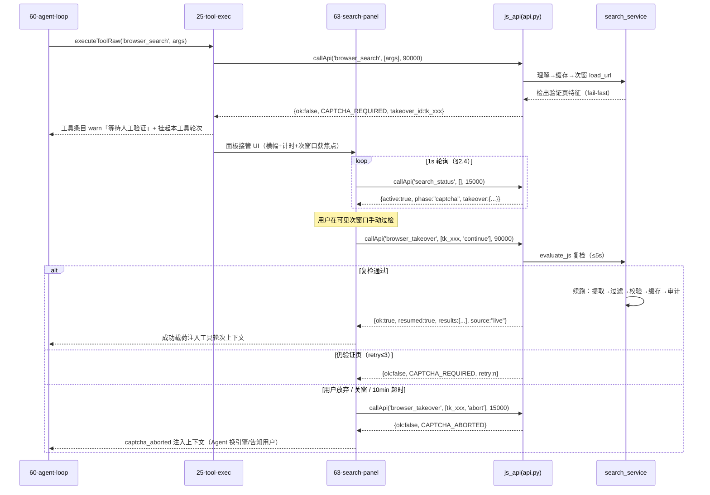

# Harbor v1.8.0「Agent 能力版」· 前后端联调规范

**日期**：2026-10-20 · **版本**：v1.0（待产品负责人审定）
**基线**：v1.7.0（701 passed / 契约 PASS）+ v1.8.0 迭代方案 + Agent 自主调研
**范围**：v1.8.0 三大能力（B 搜索 / S 软件 / H 协同）+ v1.8.5 权限地基（A1/A2）+ v1.9.0 接口预留位
**权威源头**：`v18-architecture-and-interfaces-2026-10-20.md`（§3 接口契约 / §4 联调计划）· `design/v18/ux-flows.md`（10 流程触点）· `design/v18/README.md` §7 · `iteration-plan-v18-agent-2026-10-20.md` §13
**读者**：前后端工程师（联调执行）· 测试（验收判据）· 产品（§7 裁决影响面）

---

## 0. 总则与追溯纪律

```
┌───────────────────────────────────────────────────────────────────────────┐
│ 追溯链（每个接口声明必须可查，禁止发明）                                      │
│                                                                            │
│  架构文档 §3（接口契约）─────┐                                               │
│                             ├──► 本规范 §1/§3（字段级补全：边界/默认/错误）   │
│  ux-flows 流程⑥（前后端触点）┘         │                                     │
│                                      ▼                                     │
│                          确需新增 → §8「建议新增」单列（理由+追溯+注册要求）  │
└───────────────────────────────────────────────────────────────────────────┘
```

**本规范的补全权限边界**（工程师据此判断哪些能改、哪些必须走契约变更单）：

| 类型 | 示例 | 是否需契约变更单 |
|---|---|---|
| 字段级补全 | 补默认值/边界/错误码语义（架构 §3 已声明该字段） | 否（本规范即权威） |
| 联调观测字段新增 | 响应加 `elapsed_ms`/`channel`（§3 标注【建议新增字段】） | 否（纯新增可选字段，旧消费方忽略） |
| 新 js_api 方法 | `search_status` / `browser_takeover` | **是**（§8 单列，评审后进 `_V12_EXTRA`） |
| 改动既有方法签名/返回形状 | 任何 | **是**（双方确认 + 版本号递增） |

**三条工程铁律**（全文适用，违反即返工）：
1. 所有新 js_api 必须注册 `backend/api.py` 的 `_V12_EXTRA`（`get_api_info` 输出零漂移）。
2. 新 DOM id/class 纯新增（UI 契约只增不改；`check_contract.py` 每次构建必过）。
3. `config.json` 零污染（`software.json` / `hybrid.json` / `search_cache/` / `checkpoints/` 独立文件）。

---

## §1 接口清单（联调主表）

### 1.1 B 域 · 浏览器搜索（v1.8.0）

| # | js_api 方法 | 前端调用模块 | 触发触点 | 预计耗时 | 审计 op | 版本 |
|---|---|---|---|---|---|---|
| B1 | `browser_search` | `25-tool-exec.js`（新分支）→ `63-search-panel.js`（面板） | Agent 工具循环（`60-agent-loop.js` 调 `executeToolRaw`）；无用户直接入口 | 缓存 ≤300ms / P50 ≤3s / 全链（含 extract=full）≤60s | `web_search` | 1.8.0 |
| B2 | `browser_open` | `25-tool-exec.js`（新分支）→ `63-search-panel.js`（原文预览 tab） | Agent 直接调用；或 `browser_search` extract=full 后端连锁（前端只见总进度） | 加载 ≤8s + 提取 <1s；连锁 N 篇 ≈ N×5s | `web_open` | 1.8.0 |
| B3 | `search_cache_stats` | `63-search-panel.js`（面板脚注/设置区） | 面板打开时 refresh（boot/事件/操作后三处调用，同 `refreshWsCard` 模式） | <50ms | —（读取类不落审计） | 1.8.0 |
| B4 | `search_status` 【建议新增 §8】 | `63-search-panel.js`（1s 轮询） | `browser_search` 在途期间面板轮询（进度回报通道，§2.4） | <20ms | —（轮询不落审计） | 1.8.0 |
| B5 | `browser_takeover` 【建议新增 §8】 | `63-search-panel.js`（接管按钮） | 用户点「继续」/「放弃」（ux-flows 流程 2 步骤 4a/4b） | 复检 ≤5s + 续跑管线 ≤60s | `takeover_continue` / `takeover_abort` | 1.8.0 |

### 1.2 S 域 · 外部软件调用（v1.8.0）

| # | js_api 方法 | 前端调用模块 | 触发触点 | 预计耗时 | 审计 op | 版本 |
|---|---|---|---|---|---|---|
| S1 | `software_list` | `64-software-panel.js`（设置区 `#softwareBlock`） | 设置面板打开/探测后 refresh | <50ms（探测缓存命中） | —（读取类） | 1.8.0 |
| S2 | `software_probe` | `64-software-panel.js` | 「重新探测」按钮；面板挂载时按需 | 单软件 ~340ms；全量 PATH+winreg 扫描 ≤30s | `software_probe` | 1.8.0 |
| S3 | `software_call` | `25-tool-exec.js`（新分支）+ `26-guard.js`（预检） | Agent 工具循环；设置面板「测试调用」（source=manual_test，不走 Agent guard 链，Gap-4） | CLI 5-600s（timeout 参数）；GUI 核验 ≤10s；URI <1s | `software_call` | 1.8.0 |

### 1.3 H 域 · 混合路由（v1.8.0）

| # | js_api 方法 | 前端调用模块 | 触发触点 | 预计耗时 | 审计 op | 版本 |
|---|---|---|---|---|---|---|
| H1 | `hybrid_get_config` | `65-hybrid.js`（设置区 `#hybridBlock`） | 设置面板打开时 refresh；boot 时读一次（首启默认值） | <20ms | —（读取类） | 1.8.0 |
| H2 | `hybrid_save_config` | `65-hybrid.js` | 策略/预算/置信门/分账开关变更即存 | <20ms | `hybrid_save_config` | 1.8.0 |
| — | `hybrid_stats` | — | — | — | — | **不设** |

> **H 域不设 `hybrid_stats`**：ux-flows 流程 5⑥ 标注「约数，以接口清单为准」。分账数据源已定为由 `60-agent-loop.js` 前端 usage 累加（架构 §3.3 前端触点），无需后端统计接口。路由决策日志走后端 `~/.glm-chat/logs/` + `28-audit-viewer.js` 筛选项。

### 1.4 A 域 · 任务授权与白名单（v1.8.5）

| # | js_api 方法 | 前端调用模块 | 触发触点 | 预计耗时 | 审计 op | 版本 |
|---|---|---|---|---|---|---|
| A1 | `guard_task_grant` | `66-guard-grant.js`（+ `26-guard.js` 模态） | 授权确认模态「确认」（TTL 选择 30min/2h/4h，默认 2h） | <20ms | `guard_grant`（decision=grant） | 1.8.5 |
| A2 | `guard_task_revoke` | `66-guard-grant.js` | 「收回授权」按钮 | <20ms | `guard_revoke`（decision=revoke） | 1.8.5 |
| A3 | `guard_task_status` | `66-guard-grant.js` | boot / 授权事件 / 操作后 refresh；倒计时每 30s 校准拉取一次 | <20ms | —（读取类） | 1.8.5 |
| A4 | `guard_rule_list` | `66-guard-grant.js`（白名单管理区） | 白名单区展开时 refresh | <20ms | —（读取类） | 1.8.5 |
| A5 | `guard_rule_add` | `66-guard-grant.js` | 「添加规则」/「第 3 次批准升级为规则」一键升级 | <20ms | `guard_rule_add` | 1.8.5 |
| A6 | `guard_rule_remove` | `66-guard-grant.js` | 规则行「删除」 | <20ms | `guard_rule_remove` | 1.8.5 |

### 1.5 v1.9.0 接口预留位（本期不注册、不实现、不联调；仅文档占位约定）

| # | 预留方法 | 用途 | 前端容器（本期预留 DOM） | 版本 |
|---|---|---|---|---|
| V1 | `plan_create` / `plan_update` / `plan_get` | Plan-Act 计划 CRUD | `#planCard`（`67-plan-card.js`，架构 §3.5） | 1.9.0 预留 |
| V2 | `clarify_respond` | 批量澄清表单回传（本期 clarify 伪工具在前端闭环，不走 js_api） | `#clarifyCard` | 1.9.0 预留 |
| V3 | `checkpoint_create` / `checkpoint_rollback` / `checkpoint_list` | 检查点与回滚 | `~/.glm-chat/checkpoints/` 目录约定本期写入文档 | 1.9.0 预留 |

> 注册纪律：预留方法名进 `_V12_EXTRA` 的时间与 v1.9.0 实现对齐（架构 §3.5/§5），**本期不得提前注册**（提前注册=get_api_info 漂移风险 + 死方法面）。前端 `#planCard`/`#clarifyCard` 容器 DOM 本期可预留（ux-flows Gap-9 版本归属提醒）。

### 1.6 §1 计数

| 域 | 契约方法 | 建议新增（§8） | 合计 | 本期联调范围 |
|---|---|---|---|---|
| B 搜索 | 3 | 2 | 5 | 5 |
| S 软件 | 3 | 0 | 3 | 3 |
| H 协同 | 2 | 0 | 2 | 2 |
| A 授权 | 6 | 0 | 6 | 6（v1.8.5 批次） |
| v1.9.0 预留 | 7 | 0 | 7 | 0（不联调） |
| **合计** | **21**（=14 契约 + 7 预留） | **2** | **23** | **16**（14 契约 + 2 建议新增） |

---

## §2 前端调用方式规范

### 2.1 callApi 统一序列

所有新 js_api 统一走既有桥（`frontend/src/05-bridge.js`，勿新建通道）：

```js
// 既有口径（05-bridge.js）：promise 竞速 + 显式 timeoutMs（0 值不吞）+ finally clearTimeout
async function callApi(name, argsArray, timeoutMs) { /* 既有实现，勿改 */ }
```

**调用序列（每个新调用点必须遵循的四步）**：

```
① 入口守卫     window.pywebview?.api?.[name] 不存在 → throw 'pywebview bridge 未就绪: ' + name
                （vm 沙箱：typeof window !== 'undefined' 守卫，§2.5）
② 序号登记     const seq = ++<domain>ReqSeq;        // last-wins（§2.2）
③ 竞速调用     await callApi(name, args, <timeoutMs>);   // timeoutMs 见下表，禁默认 60s 一把切
④ 序号校验     if (seq !== <domain>ReqSeq) return;  // 旧请求静默失效（仅复位按钮态）
```

**每接口 timeoutMs 建议值表**（联调执行口径；后端另有看门狗，前端超时只解放 UI，不杀后端任务）：

| 接口 | timeoutMs | 依据 |
|---|---|---|
| `browser_search` | **90000**（extract=full 时 150000） | 窗口 ≤8s + 提取 + Top N 深度提取连锁 + 校验重试 ≤2 |
| `browser_open` | **60000** | 加载 ≤8s + readability 提取 + toolcache 落盘 |
| `browser_takeover` | **90000** | 复检 ≤5s + 续跑完整管线（可能含 extract=full） |
| `search_status` | **15000** | 纯内存状态读，快失败 |
| `search_cache_stats` | **15000** | 本地目录统计 |
| `software_list` | **15000** | 注册表读 + 探测缓存 |
| `software_probe` | **120000** | PATH/winreg 全量扫描 + N×`--version` |
| `software_call` | **min(660000, timeout×1000 + 30000)** | 后端执行上限 600s + 30s 缓冲（与 `run_command` 660000 同款口径） |
| `hybrid_get_config` / `hybrid_save_config` | **15000** | 本地文件 IO |
| `guard_task_grant` / `guard_task_revoke` / `guard_task_status` | **15000** | 进程内状态读写 |
| `guard_rule_list` / `guard_rule_add` / `guard_rule_remove` | **15000** | 本地文件 IO |

> 前端竞速超时 ≠ 后端取消：`callApi` 超时只让 UI 脱离 pending（转 error + 「调用超时」人话），后端任务继续跑完并落审计。需要真取消必须走用户「停止」（§5 中断语义）。

### 2.2 三态状态机 + 请求序号 last-wins

每个域一个状态模块（`63-search-panel` / `64-software-panel` / `65-hybrid` / `66-guard-grant`），本地状态对象 + 单一 refresh 入口（boot / 事件 / 操作后三处调用，与 `refreshWsCard` 同模式，架构 §4.2）。

```
                     ┌──────────────────────────────────────────────┐
                     │  三态机（每个调用点/面板）                      │
                     │                                              │
  idle ──trigger──►  │  pending(seq=++domainReqSeq)                  │
                     │      │          │                             │
                     │      │ ok       │ err                          │
                     │      ▼          ▼                             │
                     │  success      error                           │
                     │      │          │                             │
                     │      └──► idle（可再触发）                      │
                     │                                              │
                     │  last-wins：pending 期间新 trigger             │
                     │   → seq+1 覆盖，旧请求返回后                   │
                     │   seq!==domainReqSeq → 丢弃（仅复位按钮态）     │
                     └──────────────────────────────────────────────┘
```

**同款先例**（口径复用，勿发明新竞态模式）：`36-connect.js` 的 `connectIdentifySeq`（L183 声明 / L653 `const seq = ++connectIdentifySeq` / L677/L695 `if (seq !== connectIdentifySeq) return`）。新模块命名同款：`searchReqSeq` / `softwareReqSeq` / `hybridReqSeq` / `grantReqSeq`。

**v1.8 新增域的竞态面与对策**：

| 场景 | 竞态 | 对策 |
|---|---|---|
| 面板连点「重新探测」 | 两次 `software_probe` 交叠 | `softwareReqSeq` last-wins，旧返回丢渲染 |
| 接管中重复点「继续」 | 两次 `browser_takeover(continue)` | 按钮 pending 禁用 + 后端 takeover_id 幂等（第二次返回当前态） |
| 设置面板快速切策略 | `hybrid_save_config` 连写 | 后端串行落盘（文件锁）；前端最后一次为权威 |
| Agent 循环内工具重试 | 旧工具结果晚到 | 60-agent-loop 既有 per-task 序号（v1.7 资产）复用 |

### 2.3 ≥3s 动作的可见等待（ux-flows 铁律）

**铁律**：Agent 每个 ≥3s 动作必须有可见等待/进度态——禁止静默黑箱（ux-flows TL;DR）。

**四件套与阶段文案对应表**（motion-spec §2.1 为动效真相源；本表为「后端阶段 → 前端反馈」映射）：

| 后端阶段（search_status.phase） | 阶段文案（ pill ） | 反馈形式 | >3s 升级 | 进度条 |
|---|---|---|---|---|
| `understanding` | 正在理解检索意图… | pill + 骨架 | 秒表（tool-call-item 附计时） | 不确定扫光 |
| `cache_check` | 正在检查缓存… | pill | — | 无 |
| `window_loading` | 正在打开 Bing… | pill + 秒表 | 「仍在加载（对抗懒加载）…」 | 不确定扫光 |
| `urllib_fallback` | 已切换轻量抓取（降级）… | pill（warn 色） | — | 不确定扫光 |
| `extracting` | 正在提取搜索结果… | pill | 骨架逐项替换 `.sp-item` | 无 |
| `deep_extract` | 正在读取正文（3/10） | pill + 计数微闪 | — | **确定进度** scaleX(done/total) |
| `validating` | 正在校验结果… | pill | 置信 <0.7 追「升级云端复核」 | 无 |
| `reformulate` | 校验未过，正在改写检索式重试（1/2） | pill（info 行） | — | 无 |
| `captcha` | 需要人工验证 | warn 横幅 + 接管 UI（流程 2） | 已等待计时 mm:ss | 无 |
| `done` | 搜索完成 | pill → ok 200ms，600ms 淡出 | — | — |

**pacing 五律**（motion-spec §2.1，联调验收查项）：P1 首反馈 ≤130ms；P2 阶段最短展示 400ms（防文案闪烁）；P3 阶段切换 cross-fade 且 spinner 不重启；P4 任一阶段 ≥5s 无事件 → 心跳「仍在进行…」，≥15s 追提示；P5 取消即停（全部循环动画 140ms 淡出）。

**软件域等待**（无后端进度通道，客户端时钟）：`.sw-light` probing 呼吸态；CLI 执行中不确定扫光 + 「已运行 0:42」每秒 +1 文本时钟（**不走 count-up 动画**，motion-spec §2.1 软件段）；GUI 「已发起启动，正在确认窗口出现…」+「启动后无法中止」明示。

**分账 chip 刷新**：`#costSplit` 在 usage 到达时刷新（既有 usage 事件延长，架构 §4.2），数字滚动 `--dur-count` 600ms。

### 2.4 browser_search 进度回报通道（裁决项 Gap-8，本规范给出推荐）

**问题**：`browser_search` 是同步 `callApi` 阻塞调用，阶段进度（理解中/加载中/提取中/验证页）如何送达前端？

**pywebview 能力边界**（本环境实证，联调方案设计的硬约束）：

| 能力 | 实况 | 出处 |
|---|---|---|
| js_api 方向 | **单向**：前端 → 后端同步调用；后端无法经 js_api 反向推送 | pywebview 桥机制 |
| `window.evaluate_js()` | **本沙箱会话无法被消息循环泵送（两次实证）**；且需窗口存活、无送达 ACK、JS 未就绪即静默丢失 | `deliverables/scripts/gui_walkthrough.py` 方案说明 |
| WebSocket | 后端无 | 架构 §4.2「后端推送无 WebSocket」 |
| vm harness | 无真实窗口，evaluate_js 不可测 | tests/ 既有 harness 模式 |

**两方案技术对比表**：

| 维度 | 方案 A：`search_status` 轮询（推荐） | 方案 B：evaluate_js 事件推送 |
|---|---|---|
| 通道 | 既有 callApi（新方法 `search_status`，§8） | 后端 `win.evaluate_js('window.__onSearchProgress(...)')` |
| 本环境可测性 | **vm harness 全量可测**（Mock js_api 预置响应+延迟+错误注入，既有模式） | **不可测**（无窗口；evaluate_js 沙箱不可用，两次实证） |
| 送达保证 | 每次轮询是新查询，无丢失（last-wins 天然成立） | 无 ACK；JS 未就绪/抛错即静默丢失 |
| 时序风险 | 无（前端 await 期间事件循环空闲，回程独立） | 需保证在主窗口事件循环 pump 期调用；与 pywebview 线程模型耦合 |
| 粒度 | 1s（阶段切换 400ms 最短展示下足够） | 实时（但阶段切换被人为限速 400ms，实时性无收益） |
| 额外成本 | 1 次/秒轻调用（内存状态读） | 后端持有窗口引用 + JS 全局钩子契约 |
| 与架构 §4.2 的关系 | **一致**（「轮询 + 事件钩子」既定方向） | 偏离 |

**推荐：方案 A（`search_status` 轮询，1s）。理由**：① 与架构 §4.2 既定方向一致，无契约翻动；② 走既有 callApi 通道，vm harness 可全量自动化验证（L1 门），而 evaluate_js 推送在本环境两次实证不可用、无法进任何自动化层；③ 无丢失语义 + last-wins 免费获得；④ 轮询频率对阶段文案（400ms 最短展示）无感知损失。代价（1 次/秒轻调用、多一个 `_V12_EXTRA` 方法）可接受。

**协议定义**（方案 A 落地口径，schema 见 §3.1）：

```
browser_search 在途 ──► 63-search-panel 开启 1s 轮询 search_status
                          │
                          ├─ phase=understanding/window_loading/... → 阶段 pill 轮换（§2.3 表）
                          ├─ phase=captcha + takeover{takeover_id} → 接管 UI（流程 2）
                          └─ phase=done / active=false → 停轮询
用户点「继续」──► browser_takeover(takeover_id,'continue') ──► 复检 ≤5s
                     ├─ 通过 → 续跑管线，browser_takeover 返回与 browser_search 同构成功响应
                     ├─ 仍验证页 → CAPTCHA_REQUIRED（retry+1，≤3）
                     └─ 放弃/关窗/10min 无操作 → CAPTCHA_ABORTED
```

**与 ux-flows「调用内阻塞」表述的差异说明**：ux-flows 流程 2⑤「放弃 = 本次 browser_search 调用以 captcha_aborted 失败结束」按本规范落为 **fail-fast + 前端挂起工具轮次**：`browser_search` 检出验证页即返回 `CAPTCHA_REQUIRED`（架构 §3.1 响应形状，权威），`60-agent-loop.js` 识别该码后将工具条目转 warn「等待人工验证」并挂起本工具轮次（不往上下文塞错误、不换路），`browser_takeover` 的终态（成功载荷 / `CAPTCHA_ABORTED`）才作为该工具轮次的结果注入上下文。差异收益：Agent 循环永不挂死在人类动作上。若裁决要求严格阻塞语义，切换成本见 §7 R9 备选分支。

### 2.5 vm 沙箱可测性约定（typeof 守卫模式）

**同款先例**：`71-provider.js` 的 `localProxyBase()` / `localProxyHeaders()`——`typeof window !== 'undefined'` 守卫 + 依赖注入点，vm harness 可直接求值。

```js
/* 新模块统一模式（63/64/65/66 全部适用） */
function searchPanelEl() {
  return (typeof document !== 'undefined') ? document.getElementById('searchPanel') : null;
}
function proxyBase() {
  return (typeof window !== 'undefined' && window.__localProxyBase) ? String(window.__localProxyBase) : '';
}
```

**规则**：
1. 禁止模块顶层直接引用 `window` / `document` / `localStorage`（vm 沙箱无 DOM）；一律经函数体内 `typeof` 守卫或参数注入。
2. 所有 `callApi` 调用点经统一封装（§2.1 四步），harness 可整体替换 `ctx.window.pywebview.api`。
3. Mock js_api 形状（harness 桩，既有 test_v13_qa / test_review_fixes 同款）：

```js
ctx.window.pywebview = { api: {
  browser_search:   async (args) => JSON.stringify(__fixture.search.ok),      // 预置响应
  browser_takeover: async (id, action) => { await __delay(50); return JSON.stringify(__fixture.takeover[action]); },
  // ... 错误注入：__callApiThrows=true → throw new Error('pywebview bridge gone')（test_v13_qa 同款）
}};
```

4. 倒计时/计时器可注入假时钟（`__now()` 函数级注入），TTL 递减与校准逻辑不依赖真实 `Date.now`。

---

## §3 后端响应规范（逐接口 schema）

**通用约定**（架构 §3）：所有方法返回 JSON 字符串；成功 `{ok:true, ...}`；错误 `{ok:false, error:{code, message, hint?}}`；经 `backend/errors.py` 的 `ok()/err()` 包装（不可序列化对象 `default=str` 兜底）；错误 `message` 必须人话（用户可直接读懂），`hint` 给可操作下一步。

### 3.1 B 组

#### `browser_search`（B1）

**请求字段表**：

| 字段 | 类型 | 必填 | 默认 | 边界/约束 |
|---|---|---|---|---|
| `query` | string | 是 | — | 1-500 字符；空/超长 → `BAD_PARAMS` |
| `engine` | string | 否 | `bing` | `bing\|duckduckgo\|baidu\|google\|custom`；其他值 → `BAD_PARAMS`（hint 列合法值，Agent 自校正） |
| `site` | string | 否 | — | 裸域名（`github.com`）；带协议/path 取 host；>64 字符 → `BAD_PARAMS` |
| `filetype` | string | 否 | — | 1-10 位字母数字（`pdf`/`docx`/`md`…） |
| `time_range` | string | 否 | — | `day\|week\|month\|year` |
| `lang` | string | 否 | — | `zh\|en` |
| `max_results` | int | 否 | `10` | 1-20；超界**夹逼**并回显实际值；非数字 → `BAD_PARAMS` |
| `extract` | string | 否 | `snippet` | `none\|snippet\|full` |

**成功响应**（架构 §3.1 + 联调观测字段）：

| 字段 | 类型 | 语义/边界 |
|---|---|---|
| `ok` | `true` | 固定 |
| `query` | string | 构造后的检索式回显（含 `site:`/`filetype:` 等操作符） |
| `engine` | string | 实际使用的引擎（夹逼/降级后与请求可能不同） |
| `source` | `"live"\|"cache"` | 缓存命中标注（UI 徽标真相源；§4.4） |
| `fetched_at` | ISO8601 | 抓取时间；缓存命中时为**原抓取时间** |
| `results` | array | `[{title, url, snippet, position, date, domain}]`；`position` 从 1 连续；`date` 可 `null`；`domain` 小写无端口 |
| `cached` | bool | `= (source==="cache")`，兼容镜像（架构 §3.1 既有字段，保留） |
| `truncated` | bool | toolcache 截断标记（§4.3） |
| `full_ref` | string? | `"toolcache:tc_xxx"`，仅 `truncated=true` 时出现 |
| `elapsed_ms` | int? | 【建议新增字段】后端管线耗时（P50 ≤3s 目标观测） |
| `channel` | `"window"\|"urllib"`? | 【建议新增字段】取数通道（ux-flows 流程 1 步骤 5「已降级直连抓取」标注的真相源） |
| `deep_extract` | `{done,total,failed}`? | 【建议新增字段】extract=full 时进度回显（失败单项不中断整批，完成后汇总「N 页读取失败」） |

**错误响应**：`ENGINE_UNREACHABLE`（窗口+urllib 双失败）· `CAPTCHA_REQUIRED`（fail-fast，见下）· `CAPTCHA_ABORTED` · `TIMEOUT`（8s 看门狗且兜底失败）· `NAV_BLOCKED` · `GUARD_DENIED` · `BAD_PARAMS`。

**`CAPTCHA_REQUIRED` 与 takeover_id 生命周期**（架构 §3.1 + ux-flows 流程 2 + 任务指定协议）：

```jsonc
// fail-fast 响应（检出验证页特征即返回，不吊死 Agent 循环）
{"ok": false, "error": {"code": "CAPTCHA_REQUIRED",
  "message": "搜索引擎要求人机验证",
  "hint": "请在面板中手动完成后点击继续",
  "takeover_id": "tk_xxx"}}
```

```
takeover_id 生命周期（进程内状态机，search_service 持有）：

 创建 ──► 等待用户 ──► 复检 ──► 终态
  │          │           │        ├─ resolved（原管线续跑：提取→过滤→校验→缓存→审计）
 tk_xxx    用户可见     ≤5s       ├─ aborted（captcha_aborted 回传 Agent）
 注册      窗口 show     │        └─ expired（10min 无操作自动放弃）
 绑定      +focus      重试≤3
 query/                仍验证页
 引擎/窗口
```

| 阶段 | 触发 | 前端表现 | 后端行为 | 审计 |
|---|---|---|---|---|
| 创建 | 适配器检出验证页特征（captcha/verify 元素，或「结果数为 0 + 验证特征命中」） | 工具条目 warn「等待人工验证」；`#searchPanel` 弹出 warn 横幅 + 「去验证 →」；次窗口 `show()`+`focus()`，主窗口让位 | 停轮询、**保持次窗口不关**、注册 `takeover_id`、启动 5min 提醒 / 10min 自动放弃定时器 | `web_search` decision=captcha |
| 面板轮询 | `search_status` 1s 轮询（§2.4） | 「等待手动验证…」+ 已等待计时 mm:ss；面板**不可关闭**（只能继续/放弃） | 状态就绪 | —（轮询不审计） |
| 用户完成 → 继续 | 点「继续」 | 「正在检查验证结果…」 | `browser_takeover(id,'continue')` → `evaluate_js` 复检结果页选择器 ≤5s | `takeover_continue` |
| 复检成功 | — | toast ok「验证通过，继续搜索」+ 面板恢复阶段进度 | 原管线续跑，`browser_takeover` 返回与 `browser_search` **同构的成功响应**（含 `resumed:true`） | `web_search` decision=ok |
| 复检仍验证页 | 重试 ≤3 | warn「验证未通过，请重试（1/3）」 | 返回 `CAPTCHA_REQUIRED`（retry+1） | `takeover_continue` decision=retry |
| 放弃 / 关窗 / 10min | 点「放弃」/ 窗口关闭事件 / 无操作超时 | toast「已放弃本次搜索」；Agent 收到 `captcha_aborted` 后自主决策（换引擎/告知用户） | 关次窗、清理 takeover 注册 | `takeover_abort` / `web_search` decision=aborted |

> **复检依赖 evaluate_js 的降级**：若目标机 evaluate_js 不可用（本沙箱实证限制），`browser_takeover('continue')` 回落「用户确认即信任」语义——后端直接以用户点击作为通过信号续跑（提取阶段若仍为验证页，适配器特征检测会再次检出并走 `engine_retry`/失败分支）。此降级在 L3 冒烟项② 记录实际走哪条。

#### `browser_open`（B2）

**请求字段表**：

| 字段 | 类型 | 必填 | 默认 | 边界/约束 |
|---|---|---|---|---|
| `url` | string | 是 | — | 仅 http/https；其他协议 → `NAV_BLOCKED`；空 → `BAD_PARAMS` |
| `selector` | string | 否 | — | CSS 选择器；>200 字符 → `BAD_PARAMS` |
| `max_chars` | int | 否 | `8000` | 500-50000；超界夹逼并回显 |

**成功响应**（架构 §3.1）：

| 字段 | 类型 | 语义/边界 |
|---|---|---|
| `ok` / `url` / `title` | — | 目标 URL 与页面标题 |
| `content` | string | 正文，≤ max_chars |
| `truncated` | bool | 超长截断标记 |
| `full_ref` | string? | `"toolcache:tc_xxx"`，`read_more` 取全文（§4.3） |
| `extractor` | `"readability"\|"selector"` | 实际提取方式 |
| `fetched_at` / `elapsed_ms` / `channel` | — | 【建议新增字段】同 browser_search |

**错误**：`NAV_BLOCKED` · `TIMEOUT`（8s 看门狗）· `EMPTY_CONTENT`（提取为空；正文 <200 字走 `thin_warning`——仍返回成功，响应带 `thin:true`【建议新增字段】+ 面板提示「正文过短，可能需要登录」）· `SELECTOR_NOT_FOUND` · `ENGINE_UNREACHABLE`（urllib 兜底也失败）。

#### `search_cache_stats`（B3）

请求 `{}` → 响应（架构 §3.1）：`{ok:true, entries:int, hits:int, misses:int, ttl_minutes:int, size_kb:int}`。语义与 UI 影响见 §4.4。

#### `search_status`（B4 ·【建议新增 §8】）

| 字段 | 类型 | 必填 | 默认 | 边界 |
|---|---|---|---|---|
| `takeover_id` | string | 否 | — | 缺省 = 当前活跃搜索；传入时校验归属 |

**成功响应**：

| 字段 | 类型 | 语义 |
|---|---|---|
| `active` | bool | 无活跃搜索 → `false`（其余字段缺省），前端停轮询 |
| `phase` | string | `understanding\|cache_check\|window_loading\|urllib_fallback\|extracting\|filtering\|deep_extract\|validating\|reformulate\|captcha\|done`（→ 文案映射见 §2.3） |
| `query` / `engine` | string | 当前搜索上下文（面板标题用） |
| `elapsed_ms` | int | 在途耗时（秒表数据源） |
| `takeover` | object? | `{takeover_id, state:"prompting"\|"user_verifying"\|"rechecking", elapsed_s, retries, max_retries}`，phase=captcha 时出现 |
| `deep_extract` | object? | `{done,total,failed}`，extract=full 时出现 |
| `cache_hit` | bool? | 缓存命中预标注（done 前即可知） |

**审计**：不落 `audit_log.jsonl`（1s 轮询会灌爆审计文件，稀释安全信号），仅 debug 日志。终端事件审计由 `browser_search` / `browser_takeover` 承担。

#### `browser_takeover`（B5 ·【建议新增 §8】）

| 字段 | 类型 | 必填 | 边界 |
|---|---|---|---|
| `takeover_id` | string | 是 | 不存在/已清理 → `TAKEOVER_NOT_FOUND`；10min 过期 → `TAKEOVER_EXPIRED` |
| `action` | string | 是 | `continue\|abort`；其他 → `BAD_PARAMS` |

**响应三态**：
- `continue` 且复检通过 → `{ok:true, resumed:true, ...browser_search 成功响应同构字段}`
- `continue` 且仍验证页 → `{ok:false, error:{code:"CAPTCHA_REQUIRED", takeover_id, retry:n, max_retries:3}}`
- `abort` → `{ok:false, error:{code:"CAPTCHA_ABORTED", message:"用户已放弃人工验证"}}`

**幂等**：重复 `continue` 不重复复检，返回当前态（防连点竞态）。

**人工接管序列图**（联调对齐用）：



### 3.2 S 组

#### `software_list`（S1）

请求：`{status?: "all"|"probed"|"missing"（默认 all）}` → 响应（架构 §3.2）：`{ok:true, software:[{name, kind:"cli"|"gui"|"uri", status:"probed"|"missing"|"version_mismatch"|"unknown", version?, source:"preset"|"user", risk_default, actions:[{name, risk, arg_schema}]}]}`。

- `status` 过滤作用于列表返回；`unknown`（未探测）仅在 `status=all` 可见。
- 面板状态灯映射（`.sw-light`）：`probed`→installed（绿）/ `missing`→missing（空芯）/ `version_mismatch`→mismatch（黄）/ `unknown`→ probing 态由 `software_probe` 在途时渲染。

#### `software_probe`（S2）

请求：`{name?: string（缺省=全部）}` → 响应：`{ok:true, probed:[{name, status, version?}], elapsed_ms}`。
- `name` 未注册 → `BAD_PARAMS`（hint 回显可用名）。
- 探测执行 PATH 扫描 + winreg + `--version` 验身份；`IDENTITY_MISMATCH` 在 probe 阶段即标记（防同名假冒，R5）。

#### `software_call`（S3）——三形态响应

**请求字段表**：

| 字段 | 类型 | 必填 | 默认 | 边界/约束 |
|---|---|---|---|---|
| `software` | string | 是 | — | 注册表名（小写）；未注册 → `UNKNOWN_SOFTWARE`（hint 回显可用列表，Agent 自校正） |
| `action` | string | 是 | — | 该软件 actions 之名；未知 → `BAD_PARAMS`（hint 回显可用 actions） |
| `args` | object | 是 | `{}` | 按 `action.arg_schema`；路径参数一律过工作区门禁 + realpath 归一（防 `..`/junction 越界） |
| `timeout` | int | 否 | `60` | 仅 CLI 有效，5-600；GUI/URI 忽略；超界夹逼 |

**响应（成功 · CLI 形态）**（架构 §3.2）：

| 字段 | 类型 | 语义 |
|---|---|---|
| `software` / `action` / `kind:"cli"` | — | 回显 |
| `exit_code` | int | 0=成功；非零 → 仍走此成功形状（`exit_code` 携带），或 `NONZERO_EXIT` 错误（见下） |
| `stdout` / `stderr` | string | 超长截断（§4.3） |
| `duration_ms` / `sandboxed` | — | 计时 + 沙箱标记（Job Object 收编） |
| `truncated` / `full_ref` | — | toolcache 协议 |

> **exit_code 语义裁决口径**：`exit_code=0` → 成功形状；`exit_code≠0` → **成功形状 + `exit_code` 字段**（stdout/stderr 照常返回，Agent 可读尾段自行判断）；仅当 stderr 命中人话映射表或退出码语义明确失败时，附加 `error_hint` 字段（不改变 ok:true）。`NONZERO_EXIT` 错误码保留给「执行框架级失败」（如看门狗清剿后的非零）。理由：Agent 需要原始退出码做判断，包装成 error 会损失信息。

**响应（成功 · GUI 形态）**：`{ok:true, kind:"gui", launched:true, window_verified:true, window_title:"..."}`（FindWindowW 标题核验 ≤10s）。
**响应（成功 · URI 形态）**：`{ok:true, kind:"uri", protocol:"..."}`。

**`SCHEMA_INVALID` 自校正回显**（架构 §3.2，Agent 自校正的契约核心）：

```jsonc
{"ok": false, "error": {"code": "SCHEMA_INVALID",
  "message": "参数校验失败",
  "violations": [{"path": "message", "expect": "string(必填)", "got": "number"}],
  "example": {"message": "fix: 描述"}}}
```

- `violations[]`：`path`（点路径，如 `opts.crf`）/ `expect`（人话期望）/ `got`（实际类型或值摘要）。
- `example`：按该 action 的 arg_schema 生成的**正确示例**（必填项填默认值）。
- Agent 侧自校正 ≤2 次（ux-flows 流程 4 状态机）；前端用户侧文案：「参数不符合 X 的调用规范，Agent 正在自我修正…」。

**错误码**（架构 §3.2）：`NOT_INSTALLED`（hint 带官网引导链接，**不自动下载**）· `TIMEOUT`（看门狗清剿进程树 + 「可调大 timeout 重试」+ 部分 stdout 保留）· `NONZERO_EXIT`（stderr 人话映射 + 原始尾段）· `GUI_UNCONFIRMED`（FindWindowW 超时；error 内附 `launched:true` + 「可能被 UAC/杀软拦截」）· `SCHEMA_INVALID` · `GUARD_DENIED` · `IDENTITY_MISMATCH` · `UNKNOWN_SOFTWARE`（联调补充）· `BAD_PARAMS`。

**护栏映射**（架构 §3.2，铁律）：`action.risk=read` → session 档；`mutate` → session + 审计；`dangerous` → always 强制确认（可挂 L2 任务授权，§3.4）。测试调用（S3 面板，source=manual_test）视为用户本人操作，不走 Agent guard 确认链但照常审计（Gap-4 默认分支）。

### 3.3 H 组

#### `hybrid_get_config`（H1）——「配置缺失返回默认而非报错」语义

**响应**（架构 §3.3）：

```jsonc
// 正常（~/.glm-chat/hybrid.json 存在且合法）
{"ok": true, "config": {"strategy":"auto","local_budget_understand_s":5,
  "local_budget_validate_s":3,"confidence_gate":0.7,"cost_split_display":true},
  "source": "file"}
// 缺失/损坏（首启零配置可用——不报错）
{"ok": true, "config": {...同上默认值...}, "source": "default"}
```

| 场景 | 后端行为 | `source` |
|---|---|---|
| 文件存在且合法 | 读取返回 | `file` |
| 文件缺失（首启） | 返回默认值 + 顺带落盘默认（幂等，避免每次 default） | `default` |
| 文件损坏（JSON 解析失败） | 原文件改名 `hybrid.json.corrupt-<ts>` 备份 + 落盘默认 + 返回默认 | `default` |

**默认值全集**：`strategy="auto"` · `local_budget_understand_s=5` · `local_budget_validate_s=3` · `confidence_gate=0.7` · `cost_split_display=true`。前端据此渲染，`source="default"` 时设置区显示「首次使用，已载入默认配置」轻提示（不弹模态）。

#### `hybrid_save_config`（H2）

**请求**（部分更新语义，缺省取当前值）：

| 字段 | 类型 | 必填 | 默认 | 边界 |
|---|---|---|---|---|
| `strategy` | string | 否 | 当前值 | `auto\|saver\|quality` |
| `local_budget_understand_s` | int | 否 | 当前值 | 1-30 |
| `local_budget_validate_s` | int | 否 | 当前值 | 1-30 |
| `confidence_gate` | float | 否 | 当前值 | 0.5-0.95 |
| `cost_split_display` | bool | 否 | 当前值 | — |

**响应**：`{ok:true, config:{...合并后全量...}}`；字段级校验失败 → `BAD_PARAMS`（hint 指明字段与合法域）。写 `~/.glm-chat/hybrid.json`（独立文件，config.json 零污染）。策略切换即时生效于**下一回合**，当回合不中断（ux-flows 流程 5⑤）。

### 3.4 A 组（v1.8.5）

#### `guard_task_grant` / `guard_task_revoke` / `guard_task_status`（A1/A2/A3）

**grant 请求**（架构 §3.4）：

| 字段 | 类型 | 必填 | 默认 | 边界 |
|---|---|---|---|---|
| `scope` | string[] | 是 | — | 枚举数组：`workspace_write` / `exec` / …；空数组或非法枚举 → `BAD_PARAMS` |
| `ttl_seconds` | int | 否 | `7200` | 60-86400；超界 → `BAD_PARAMS`（hint 列合法域，安全参数不静默夹逼） |

**grant 响应**：`{ok:true, grant_id:"g_xxx", expires_at:"ISO8601", remaining_s:7200, scope:[...], granted_by:"user"}`。

**revoke 请求**：`{grant_id?: string（缺省=当前）}` → `{ok:true, revoked:bool}`（`false`=本就无授权，**幂等**）。

**status 响应**：`{ok:true, active:true, grant_id, expires_at, remaining_s, scope, granted_by}`；`active=false` 时其余字段缺省。

**TTL / scope / 倒计时字段语义**（联调执行口径）：

| 字段 | 语义 | 前端消费 |
|---|---|---|
| `expires_at` | `granted_at + ttl_seconds`（ISO8601 UTC） | 授权建立时记录 |
| `remaining_s` | `max(0, expires_at - now)`（后端权威） | **校准源**：本地每 1s 递减，每 30s 重新 `guard_task_status` 校准一次（防本地时钟漂移） |
| `scope` | 授权范围枚举数组 | `#taskGrantBar` 副文案 `.gr-scope` |
| 剩余 <600s | 后端在 status 附 `expiring_soon:true`【建议新增字段】 | 灯变黄 + 倒计时高亮 + 「重新授权」入口 |

**铁律**（架构 §3.4，违反即安全回退）：grant = 提权**不是免检**——deny 清单（工作区外写/提权/凭证外传/永久删除关键路径/guard off）**先于** grant 生效；授权内操作审计记 `decision=grant`（不逐条 toast，防噪）；TTL 到期自动失效；授权绑定 task_id，新会话/新任务需重新授权。

#### `guard_rule_list` / `guard_rule_add` / `guard_rule_remove`（A4/A5/A6 · L4 白名单）

**add 请求**（架构 §3.4）：

| 字段 | 类型 | 必填 | 边界 |
|---|---|---|---|
| `op_pattern` | string | 是 | 空 → `BAD_PARAMS`；非法正则 → `BAD_PARAMS` |
| `detail_pattern` | string | 否 | 非法正则 → `BAD_PARAMS` |
| `note` | string | 否 | ≤200 字符 |

**add 响应**：`{ok:true, rule_id:"r_xxx", warn?}`——`warn` = detail 含写动词时的宽模式确认提示（**不阻断**，架构 §3.4）；deny 清单覆盖的规则创建时即拒 → `GUARD_DENIED`。

**list 响应**：`{ok:true, rules:[{rule_id, op_pattern, detail_pattern?, hits:int, created_at:"ISO8601", note?}]}`。
**remove 请求**：`{rule_id: string 必填}` → `{ok:true, removed:bool}`（幂等）。

**语义**（架构 §3.4）：窄规则 > 松模式；规则命中审计记 `decision=rule`；删除即时生效。

### 3.5 v1.9.0 预留位声明

本期只占位不实现：`plan_create`/`plan_update`/`plan_get`、`clarify_respond`、`checkpoint_create`/`checkpoint_rollback`/`checkpoint_list`。**联调动作**：无（不注册、不调用、不断言）；仅文档约定 `~/.glm-chat/checkpoints/` 目录语义（架构 §3.5）。clarify 伪工具走前端闭环（工具面，非 js_api，ux-flows 流程 9⑥）。

---

## §4 数据格式与状态码

### 4.1 HTTP 层映射（本地代理/urllib 透传 → 人话业务码）

| 上游 HTTP | 场景 | 映射为 | 前端动作 |
|---|---|---|---|
| `503` | 本地端点（Ollama model is loading） | hybrid 错误分类 = `loading` → **快速失败降级云端**（复用 45-request-debounce 既有 503 指数退避口径，不等满预算） | 阶段 chip 正常轮换 + 流程 6 边界提示 |
| `429` | 引擎限流 | `ENGINE_UNREACHABLE` + hint「引擎限流，可稍后重试或切换引擎」 | toast + 「重新搜索」按钮 |
| `403` | 引擎反爬拦截 / custom 模板无权限 | `ENGINE_UNREACHABLE`；结果页检出验证特征 → `CAPTCHA_REQUIRED` | 按对应码走 |
| `404` | custom 引擎 URL 模板错误 | `ENGINE_UNREACHABLE` + hint「检查 custom 引擎模板」 | toast err |
| `5xx` | 引擎服务端错误 | `ENGINE_UNREACHABLE` + hint「稍后重试」 | toast + 重试 |
| 连接拒绝 / 超时 | 本地端点不可用 | local_model_service 既有分类（`unreachable`）→ 降级 + 3 连败标记 unavailable | 流程 6 状态灯 + 提示边界 |
| 代理 `403` | `X-Harbor-Target` 非回环目标 | 本地代理安全硬约束（`local_proxy.py`），**内部事件**——不进 Agent 上下文、不上 UI | 仅后端 warning 日志 |

> urllib 透传口径：`search_browser` 的兜底抓取复用既有 `urlopen_no_redirect`（禁自动重定向，`mcp_transport_http` 同款）；HTTP 错误按上表映射，`URLError`/socket 超时归 `TIMEOUT`（看门狗）或 `ENGINE_UNREACHABLE`（双失败）。

### 4.2 业务错误码全集表

| 错误码 | 归属接口 | 含义 | 前端动作 | 可重试 |
|---|---|---|---|---|
| `BAD_PARAMS` | 全部 | 参数校验失败（类型/必填/枚举/越界） | 条目 fail + hint 回显；Agent 自校正 | 是（改参后） |
| `GUARD_DENIED` | 全部受护栏方法 | 护栏拦截（三档/deny 名单/规则） | 按 `guard_check` action 走确认模态或阻断提示 | 否（需用户决策） |
| `CAPTCHA_REQUIRED` | browser_search / browser_takeover | 需人工验证 | 面板接管 UI + 1s 轮询（§2.4） | 是（takeover 后） |
| `CAPTCHA_ABORTED` | browser_search / browser_takeover | 用户放弃/关窗/10min 超时 | toast「已放弃本次搜索」；Agent 换路 | 是（换引擎） |
| `TAKEOVER_NOT_FOUND` | browser_takeover | 接管会话不存在/已被清理 | 面板复位 + 「重新搜索」 | 是 |
| `TAKEOVER_EXPIRED` | browser_takeover | 接管超时（10min 无操作） | 同上 + toast warn | 是 |
| `ENGINE_UNREACHABLE` | browser_search / browser_open | 窗口+urllib 双失败 / 引擎 4xx5xx | toast + 换引擎建议 | 是 |
| `TIMEOUT` | browser_search / browser_open / software_call | 看门狗超时 | 人话 + 可操作提示（调大 timeout / 重试） | 是 |
| `NAV_BLOCKED` | browser_search / browser_open | 禁导航（file:// 等，R2 纪律） | 错误回显 | 否（换 url） |
| `EMPTY_CONTENT` | browser_open | 提取为空 | 「正文过短」提示 + 「在主窗口打开链接」 | 是 |
| `SELECTOR_NOT_FOUND` | browser_open | 选择器未命中 | 提示换 selector | 是 |
| `NOT_INSTALLED` | software_call / software_probe | 软件未安装 | err + 「去官网下载」链接（**不自动下载**） | 否（安装后） |
| `UNKNOWN_SOFTWARE` | software_call | 注册表无此软件 | hint 回显可用列表 | 是（改名） |
| `IDENTITY_MISMATCH` | software_probe / software_call | `--version` 验名失败（防同名假冒，R5） | 安全警告 + 建议检查 PATH | 否 |
| `NONZERO_EXIT` | software_call | 执行框架级非零失败 | stderr 人话映射 + 原始尾段 | 视情况 |
| `GUI_UNCONFIRMED` | software_call | FindWindowW 标题核验超时 | warn「可能被 UAC/杀软拦截」+ 检查指引 | 是 |
| `SCHEMA_INVALID` | software_call | 参数 schema 校验失败 | violations + example 回显；自校正 ≤2 | 是（改参后） |
| `INTERNAL` | 全部 | 后端未捕获异常 | 通用错误 toast + 审计 decision=error | 否（先修 bug） |
| `BRIDGE_TIMEOUT` | 前端侧（非后端码） | callApi 竞速超时（§2.1） | 「调用超时」人话；后端任务继续 | 是（一次） |
| `BRIDGE_NOT_READY` | 前端侧 | pywebview 桥未就绪 | 「请在 Harbor.exe 桌面端中使用此功能」（既有口径） | 否 |

### 4.3 数据格式细节

| 项 | 约定 |
|---|---|
| **时间** | 全部 ISO8601（`expires_at`/`fetched_at`/`created_at`/`date`）；后端生成用时区感知 UTC（`...+00:00` 或 `Z` 二选一，全库统一后者）；前端展示转本地 |
| **token 分账数字格式** | `#costSplit` chip：`本地 X tok · 云端 Y tok · 省 ≈¥Z`；X/Y 千分位整数（`12,345`）；Z 两位小数；本地 tok 计费 ¥0 但计入统计；节省 = Σ(本地 tok × 对应云端单价)，内部浮点、展示两位小数；≥¥10000 显示 `≈¥9.9k`（一位小数）；数字滚动 `--dur-count` 600ms |
| **toolcache full_ref 协议** | `full_ref = "toolcache:tc_xxx"`；仅当 `truncated=true` 时出现；前端/Agent 经既有 `read_more(cache_id, offset, limit)` 续读（400-2000 字/段）；`full_ref` 不传原始内容，只传引用 |
| **truncated 标记** | 序列化后超限即置 `true` 并落 toolcache；适用于 `results`/`stdout`/`stderr`/`content` 四类载荷；截断处在内容尾追加 `\n...[truncated, full_ref:toolcache:tc_xxx]` |
| **布尔/空值** | 可选字段一律「缺失即缺省」，不用 `null` 充数（`date` 例外：源无日期时 `null`） |
| **JSON 字符串返回** | 所有 js_api 返回 JSON 字符串（既有协议）；前端 `JSON.parse` 后判 `ok` |

### 4.4 缓存语义（C1）

| 项 | 约定 |
|---|---|
| TTL | 30 分钟（`ttl_minutes` 可配）；命中判定 = 归一化 key 相同且 `now - fetched_at ≤ TTL` |
| 归一化 key | `engine + query + site + filetype + time_range + lang`；URL 归一（去 utm 等跟踪参数、小写 scheme/host、去默认端口、去末尾 `/`） |
| 命中标注 | 响应 `source="cache"` + `cached=true` + `fetched_at` 为原抓取时间；`elapsed_ms` 应 ≤300ms（P50 目标） |
| UI 影响 | `#searchPanel` 结果头徽标：实时 = `.sp-src`（中性色）/ 缓存 = `.sp-src.cache`（warn 色 + 「缓存」文案）；工具条目完成态追加「（缓存 · 0.3s · 来源 Bing）」 |
| 统计 | `search_cache_stats` → 面板脚注「缓存 12 条 · 命中 34 / 未命中 40 · 820KB」 |
| 陈旧边界 | TTL 外信息可能已变（R6）：UI 明示获取时间；一键清理入口见 §8（`search_cache_clear`，P2） |

---

## §5 异常情况矩阵

> 降级链三原则（架构 §1 分层原则）：任一层失效不架空其余层；降级**机制**可静默（不阻塞主流程），降级**事实**按 ux-flows 流程 6 边界表让用户知道。

### 5.1 显式降级链（三条，联调必测）

```
① GLM 端点双通道（R1 缓解 + 架构 §5 行为兼容）：
   GLM 端点 + enableSearch ──► 内置 web_search（黑盒）与 browser_search（受控）双通道并存，按端点自动选
                                  │
                                  └─ browser_search 遇反爬/引擎不可达 ──► Agent 可换路：换引擎 / 改告知用户
                                     （Gap-3 备选分支：include_agent 下 GLM 场景只下发 browser_search，见 §7 R11）

② 混合路由本地不可用（ux-flows 流程 6，机制=现行为静默降级）：
   本地请求超 5s/3s 预算 或 连接失败（快速失败，不等满预算）
        │
        ▼
   静默降级云端（当前步骤）── 告知边界（流程 6 表）：
       本会话首次降级 → toast warn（隐私：谁在处理数据）
       重复降级 → 静默（首次已建立认知）
       3 连败 → unavailable：灯灰 + toast + 60s 周期探测
       探测恢复 → toast ok + 灯绿
       saver 策略下任何降级 → 每次必提示（违背省钱意图且产生费用）

③ browser_search 次窗失败回落 urllib（R2 缓解）：
   次窗 load_url 超 8s / 窗口不可用 / evaluate_js 时序不稳
        │
        ▼
   urllib 抓 HTML 兜底（非 JS 渲染引擎可用）── 成功 → 响应 channel="urllib"，面板标注「已降级直连抓取」
                                          └─ 也失败 → ENGINE_UNREACHABLE（JS 渲染引擎如 google 的 urllib 兜底可能只得空壳，
                                                      面板明示「该引擎依赖 JS 渲染，建议切换 Bing/DuckDuckGo」）
```

### 5.2 B 域 · 搜索异常矩阵

| 异常类型 | 前端表现 | 后端行为 | 审计记录 |
|---|---|---|---|
| 网络失败（窗口+urllib 双失败） | 条目 fail + toast err「页面加载超时，可重试或换个引擎」+「重新搜索」按钮 | 双通道各试一次；HTTP 码按 §4.1 映射；归 `ENGINE_UNREACHABLE` | `web_search` decision=error |
| 超时（8s 看门狗） | 面板标注「已降级直连抓取」或 fail | 走 urllib 兜底；兜底成功继续、失败归 `TIMEOUT` | `web_search` decision=degrade |
| 引擎反爬（验证页） | warn 横幅 + 接管 UI（流程 2，§3.1 生命周期） | fail-fast `CAPTCHA_REQUIRED` + takeover_id + 5min/10min 定时器 | `web_search` decision=captcha |
| 参数幻觉（query 空/engine 非法） | 条目 fail + hint 回显 | `BAD_PARAMS`（不静默回默认——防幻觉被吞） | `web_search` decision=block |
| 护栏拦截 | session 档：会话首次确认模态；dangerous：always 强制确认 | `guard_check` 前置；`GUARD_DENIED` 时后端 enforce 再拒 | `web_search` decision=block/confirm |
| 本地端点不可用（H1 理解阶段） | 无感（Agent 用原参继续） | 静默降级：LLM 原参 + 轻提示（ux-flows 流程 6「参数补全失败可静默」行） | `hybrid_route` decision=degrade |
| 竞态（last-wins） | 旧 seq 返回丢弃，仅复位按钮态 | 无（纯前端关注点） | — |
| 用户中断（abort） | 条目「⊘ 已取消」；已成功的 extract=full 单篇保留缓存但不入本次上下文 | 关次窗（或 60s 空闲回收）；结果丢弃；缓存写入这类无副作用收尾不可取消 | `web_search` decision=cancel |

### 5.3 S 域 · 软件异常矩阵

| 异常类型 | 前端表现 | 后端行为 | 审计记录 |
|---|---|---|---|
| 网络失败 | **不适用**（纯本地执行；探测走 PATH/winreg 无网络） | PATH 扫描失败 → `software_list` status=`unknown` | `software_probe` decision=unknown |
| 超时（看门狗） | 「已终止（超过 Ns 上限）。可调大 timeout 重试」+ 部分 stdout 保留展示 | Job Object 清剿进程树（无孤儿） | `software_call` decision=killed |
| 软件未安装 | err「未检测到 X」+「去官网下载」链接按钮 | `NOT_INSTALLED` + 官网 hint；**不自动下载**（供应链纪律） | `software_call` decision=block |
| 参数幻觉 | 「参数不符合 X 的调用规范，Agent 正在自我修正…」→ 重试成功转 done | `SCHEMA_INVALID` + violations/example；Agent 自校正 ≤2 | `software_call` decision=block |
| 护栏拦截 | 高危确认模态（人话描述 + 参数明细 + 风险标签 + 「永久信任」勾选） | `guard_check` → action=confirm/block；dangerous→always | `software_call` decision=confirm/block/grant |
| GUI 未确认 | warn「已发起启动但未检测到窗口（可能被 UAC/杀软拦截）」 | `GUI_UNCONFIRMED`（error 内 `launched:true`） | `software_call` decision=unconfirmed |
| 竞态（last-wins） | 面板连点「测试调用」：旧返回丢弃 | 后端串行执行（软件注册表文件锁） | — |
| 用户中断（abort） | CLI：「已终止执行」+ 部分输出；GUI：**启动不可逆**（执行前停止才有效，launching 态已明示） | CLI：清剿进程树；GUI/URI：无中止语义 | `software_call` decision=cancel |

### 5.4 H 域 · 协同异常矩阵

| 异常类型 | 前端表现 | 后端行为 | 审计记录 |
|---|---|---|---|
| 本地端点不可用 | 灯灰 + 流程 6 边界提示（§5.1②） | 快速失败（连接拒绝不等预算）；3 连败 → unavailable + 60s 周期探测 | `hybrid_route` decision=degrade |
| 超时（5s/3s 预算） | 同降级边界；understand ≥5s 追「本地响应偏慢，即将切换云端」 | 硬超时即降级，绝不阻塞主流程 | `hybrid_route` decision=degrade |
| 置信门 <0.7 | info「本地校验置信度 0.55，升级云端复核」 | 云端复核或 reformulate ≤2；重试耗尽云端兜底终稿 | `hybrid_route` decision=escalate |
| 策略切换竞态 | 当回合不中断；下一回合生效（设置内 toast 确认） | 读配置按回合快照 | `hybrid_save_config` decision=allow |
| 用户中断（abort） | 本地/云端请求全部 abort（AbortController）；分账保留已发生部分 | 本地请求作废不重试（防停止后仍耗云端额度） | `hybrid_route` decision=cancel |
| 分账渲染异常 | usage 缺失时 chip 隐藏（不显示 0/0 假象） | 路由日志照常落 `~/.glm-chat/logs/` | — |

### 5.5 A 域 · 授权异常矩阵（v1.8.5）

| 异常类型 | 前端表现 | 后端行为 | 审计记录 |
|---|---|---|---|
| deny 清单命中（授权内） | 确认模态附注「超出任务授权范围：删除工作区外路径」——授权不是免检 | deny 清单**先于** grant 生效（判定序：deny → allow_rules → task_grant → op 档 → 弹窗） | `guard_check` decision=block |
| TTL 到期 | 灯灰「已到期」+ toast warn「任务授权已到期（2h），后续操作将逐项确认」 | 定时器自动失效；`remaining_s=0` | `guard_grant` decision=expired |
| 进行中调用竞态（到期/收回 vs 在途执行） | 在途条目照常完成；新调用逐项确认 | **默认分支（Gap-1 建议）**：进行中调用允许完成（写入宽限），新调用需确认；备选：立即中断（§7 R8） | `guard_revoke` decision=revoke |
| 用户收回 | 灯灰「已收回」+ toast；立即失效**未来**放行，不追溯已放行 | `guard_task_revoke` 幂等 | `guard_revoke` decision=revoke |
| 竞态（last-wins） | 倒计时每 30s 校准拉取；旧 status 返回丢弃 | `grantReqSeq` 前端序号 | — |
| 白名单宽模式 | add 响应 `warn` 黄条提示（不阻断） | detail 含写动词 → warn | `guard_rule_add` decision=allow |

### 5.6 横切：中断（abort）总语义

| 层 | 停止行为 | 数据保留 |
|---|---|---|
| browser_search / browser_open | 调用作废 + 关次窗 + 结果丢弃 | 已成功单篇留缓存（标注「未纳入本次结果」） |
| software_call（CLI） | Job Object 清剿进程树 | 部分 stdout 保留展示 |
| software_call（GUI/URI） | **启动不可逆**（执行前停止有效） | — |
| 混合路由回合 | 本地/云端全部 abort；本地作废不重试 | 分账保留已发生部分 |
| 接管等待 | 等同放弃 + 关窗 | — |
| 收尾动作（缓存写入/审计） | 不可取消 | — |

---

## §6 联调通过标准（可执行验收）

### L0 契约门（自动化，每次构建；不过 = 禁止进入 L1）

| # | 检查项 | 通过判定（命令/数字） | 失败回流 |
|---|---|---|---|
| L0-1 | 新方法全进 `_V12_EXTRA` | `python -c "from backend import api; extra=api._V12_EXTRA; need={'browser_search','browser_open','search_cache_stats','software_list','software_probe','software_call','hybrid_get_config','hybrid_save_config','guard_task_grant','guard_task_revoke','guard_task_status','guard_rule_list','guard_rule_add','guard_rule_remove'}; assert need<=extra, need-extra"` 退出码 0（v1.8.5 批次追加 A 组断言；§8 两方法评审通过后追加） | 回工程师 |
| L0-2 | `get_api_info` 零漂移 | `tests/test_api_contract.py` 既有用例全绿 + 新增 `test_v18_contract.py::test_get_api_info_byte_identical`（与 v1.7.0 基线快照 diff 为空） | 回工程师 |
| L0-3 | `build_tools(include_agent)` 差分 | `build_tools('full')` 与 legacy 快照逐字节一致；`build_tools('full', include_agent=True)` 增量恰为 browser_*/software_* 工具族（browser_search/browser_open/software_call 三条定义；功能开关关闭时对应定义不出现） | 回工程师 |
| L0-4 | config.json 零污染 | `test_v18_contract.py::test_config_json_untouched`：跑完全部写操作后 config.json 字节不变；software.json/hybrid.json/search_cache/ 独立生成 | 回工程师 |
| L0-5 | UI 契约只增不改 | `python deliverables/design/check_contract.py` 退出码 0（40 id/13 onclick/43 callApi/39 类/21 变量零改动——新方法为**新增** callApi 调用点，不减既有） | 回工程师 |

**L0 总判定**：5/5 通过才许进 L1。任何一项失败 → 回工程师修契约（禁止「先联调后补契约」）。

### L1 Mock 联调（本环境全绿；不过 = 禁止进入 L2）

| # | 检查项 | 通过判定 | 失败回流 |
|---|---|---|---|
| L1-1 | vm harness + Mock js_api 跑面板状态机 | `tests/test_v18_panels.py` 全绿：`63-search-panel` 阶段文案轮换/缓存徽标/结果渲染/骨架→`.sp-item` 替换；`64-software-panel` 三形态响应渲染（exit chip/stdout/ GUI launched/URI protocol）；`65-hybrid` 配置表单状态机 + `#costSplit` 数字格式（千分位/两位小数/k 缩写） | 回工程师 |
| L1-2 | 倒计时 | `66-guard-grant` TTL 本地递减（假时钟注入）+ 30s 校准 + 剩余 <600s 黄牌 + 收回/到期两终态渲染 | 回工程师 |
| L1-3 | 接管流 | Mock `CAPTCHA_REQUIRED` → 面板接管 UI → `browser_takeover` continue/abort 两分支 → 工具轮次挂起/注入语义（§3.1 序列图逐步断言） | 回工程师 |
| L1-4 | 分账 chip | usage 事件到达 → `本地 X tok · 云端 Y tok · 省 ≈¥Z` 渲染 + 缺失 usage 时隐藏 | 回工程师 |
| L1-5 | fixture 跑适配器纯函数 | `tests/fixtures/v18/`（Bing/DDG/Baidu/Google 结果页各 1-2 + 文章页 ×2 + 软件探测响应 ×3 + 降级时序脚本 ×1）驱动 `search_adapters`/`search_extract`：每 fixture 提取 ≥10 条含 title/url/snippet（文章页主体完整、去导航广告） | 回工程师 |
| L1-6 | 全量回归 | `pytest tests/` 全绿：701 既有 + v18 新增 ≥40 用例，合计 ≥741 passed | 回工程师 |

**L1 总判定**：6/6 通过。fixture 即契约的一部分，随契约变更单更新（架构 §4.3）。

### L2 集成联调（本环境部分可为；不含真 WebView2 窗口）

| # | 检查项 | 通过判定 | 失败回流 |
|---|---|---|---|
| L2-1 | 假引擎回环服务器 | `tests/test_v18_integration.py`：起 `ThreadingHTTPServer` 回环当假引擎（返回 fixture HTML），`browser_search`/`browser_open` 走 **urllib 兜底路径**全链通（无窗口环境自动降级，响应 `channel="urllib"`）；429/403/503/404 按 §4.1 映射断言 | 回工程师 |
| L2-2 | 假软件端点 | 本地无害 CLI（`git --version` / echo 脚本）真执行：`software_probe`→`software_call` CLI 形态（exit_code/stdout/duration_ms/sandboxed 断言）；GUI/URI 形态用假窗口标题核验（L2 以「未确认」路径为主） | 回工程师 |
| L2-3 | guard 状态机 | `guard_task_grant` → `guard_task_status`（remaining_s/expires_at/scope）→ 授权内放行（decision=grant）→ 越界仍拦 → `guard_task_revoke` → status active=false；`guard_rule_add/list/remove` + deny 覆盖即拒 | 回工程师 |
| L2-4 | hybrid 配置 | `hybrid_get_config` 首启 default 语义（删 hybrid.json → source="default" + 落盘）+ 损坏备份（.corrupt-ts）+ `hybrid_save_config` 部分更新 + 字段级 BAD_PARAMS | 回工程师 |
| L2-5 | 覆盖面 | §1 全部 14 个契约方法至少一次成功路径 + 主要错误路径（每方法 ≥1 正 1 反） | 回工程师 |

**L2 总判定**：5/5 通过。失败先分诊：契约歧义（双方理解不一致）→ **回架构师**出契约变更单；实现 bug → 回工程师。

### L3 真机冒烟（目标机 checklist；7 项全列，架构 §4.4 item 3）

| # | 冒烟项 | 通过判定 |
|---|---|---|
| ① | Bing 搜索三步（查询→提取→深度打开） | 结构化结果 ≥10 条；browser_open 正文完整；全链 UI 无静默黑箱（每阶段可见） |
| ② | 反爬人工接管 | 验证页 → 面板弹出 + 次窗口获焦点 → 手动过检 → 继续 → 复检成功续跑；放弃路径 captcha_aborted |
| ③ | git/ffmpeg 真实调用（CLI+GUI） | CLI 沙箱执行 + 结构化返回；GUI FindWindowW 核验通过 |
| ④ | Ollama 协同全链（理解→执行→校验→分账） | 阶段 chip 轮换；分账双列增长；路由日志可查 |
| ⑤ | 降级：拔本地端点 | 5s 内降级云端 + 用户可见提示（首次/toast）；3 连败 unavailable + 灯灰；恢复 toast + 灯绿 |
| ⑥ | L2 授权全周期（授予→自动放行→越界仍拦→收回） | 倒计时常驻；授权内 decision=grant；越界仍拦 + 模态附注；收回立即失效 |
| ⑦ | 白名单「第 3 次批准升级为规则」 | 确认模态第三次出现「升级为规则」入口 → add → 后续命中 decision=rule 不再弹确认 |

**L3 总判定**：7/7 通过。任一失败 → 记录复现步骤回工程师；若冒烟暴露契约缺口 → 回架构师评估变更单。

### 6.5 回流路径总图

```
L0 失败 ──► 回工程师（契约破坏，禁进联调）
L1 失败 ──► 回工程师（纯逻辑/渲染 bug）
L2 失败 ──► 分诊：契约歧义 → 回架构师（变更单）｜实现 bug → 回工程师
L3 失败 ──► 回工程师（复现步骤）＋契约缺口 → 回架构师
任何层发现「接口声明无法追溯到架构 §3 / ux-flows」──► 回架构师（§8 或变更单）
```

---

## §7 待裁决项对接口的影响矩阵（11 项）

> 阅读规则：**默认分支 = 本规范当前写法**（规范不依赖裁决即可执行）；切换分支只改「改面」所列位置，不动其他章节。来源：README §7（7 问 + 4 项 UX Gap）。

| # | 裁决项 | 裁决选项 | 受影响接口/字段 | 规范默认分支 | 切换分支的改面（文件/位置） |
|---|---|---|---|---|---|
| R1 | 搜索默认引擎 + U1 首批范围 | A：默认 Bing + U1 随首批 / B：默认 DuckDuckGo 或 U1 延后 v1.8.1 | `browser_search.engine` 默认值；`63-search-panel` 接管 UI 是否本期交付 | **A**（Bing + U1 随首批，迭代方案 §13.1 建议已采纳为 P1） | 后端：`search_service.py` 默认引擎常量 + `search_adapters.py` 模板注册；前端：`110-boot.js` 功能分级开关挂载 `63-search-panel.js` |
| R2 | software_call 默认风险档位 | A：预设分级（read→session / mutate→session+审计 / dangerous→always） / B：dangerous 降档 | `software_call` 护栏映射（§3.2 末）；`guard_check` 定档输入 | **A**（用户可调，迭代方案 §13.2 建议） | 后端：`software_service.py` 预设表 `risk` 字段 + `guard.json` 档位 |
| R3 | 混合路由默认策略 + saver 提示 | A：默认 auto + saver 长驻「质量可能下降」chip / B：saver 无提示 | `hybrid_get_config.config.strategy` 默认值；`65-hybrid.js` saver chip | **A**（auto 默认，架构 §5 行为兼容） | 后端：`hybrid_router.py` 默认策略常量；前端：`65-hybrid.js` chip 渲染条件 |
| R4 | 版本合发或拆分 | A：合发 v1.8.0 / B：拆 v1.8.0（搜索+软件）+ v1.8.1（混合） | §1 版本列；S/H 组方法进 `_V12_EXTRA` 的批次 | **A**（APP_VERSION 1.8.0，架构 §5 版本策略） | 后端：`api.py` `_V12_EXTRA` 分两批注册；前端：`100-send.js`/`110-boot.js` 功能分级开关 |
| R5 | A1/A2 是否提前插 v1.8.5 | A：维持 v1.8.5 / B：提前进 v1.8.0 | A 组 6 方法注册时间；`66-guard-grant.js` 交付批次 | **A**（v1.8.5，架构文档既定范围） | 后端：`api.py` `_V12_EXTRA`；前端：`110-boot.js` 挂载批次 |
| R6 | L2 授权 TTL 语义 | A：2h 固定（默认 7200s）/ B：任务生命周期 + 空闲 30min 收回 | `guard_task_grant.ttl_seconds` 默认值；`guard_task_status.remaining_s` 语义；`#taskGrantBar` 倒计时校准源 | **A**（架构 §3.4 既定默认 7200） | 后端：`guard_service.py` grant TTL 策略分支；前端：`66-guard-grant.js` 倒计时与「重新授权」入口 |
| R7 | 检查点保留策略 | A：保留至下个任务开始 / B：完成即清 | v1.9.0 `checkpoint_*` 预留位语义（本期仅文档约定）；`~/.glm-chat/checkpoints/` 清理时机 | **A**（ux-flows Gap-10 按此设计，策略留 v1.9.0 配置文件） | v1.9.0 `checkpoint_service.py` 保留策略配置项（**本期无代码面**） |
| R8 | 【UX Gap】L2 进行中调用竞态（到期/收回 vs 在途执行） | A：进行中允许完成（写入宽限），新调用需确认 / B：立即中断在途 | `guard_task_revoke`/TTL 到期对在途 `software_call`/`run_command` 的处理（§5.5 竞态行） | **A**（ux-flows Gap-1 建议） | 后端：`guard_service.py` grant 失效时的在途调用处理分支；前端：`66-guard-grant.js` 收回时的进行中条目提示文案 |
| R9 | 【UX Gap】browser_search 进度回报通道 | A：`search_status` 轮询（1s） / B：evaluate_js 事件推送 | `search_status` 是否存在（§2.4/§8）；`63-search-panel` 阶段渲染数据源；`browser_takeover` 是否需要 | **A**（本规范推荐：可本环境自动化验证，架构 §4.2 方向一致） | 后端：删 `search_status` 注册，改 `search_service` 持窗口引用调 `win.evaluate_js('window.__onSearchProgress(...)')`（装配点 `main.py` `_set_window`）；前端：`63-search-panel.js` 改监听 `window.__onSearchProgress` 钩子 |
| R10 | 【UX Gap】saver 下降级必提示 vs 省钱意图 | A：saver 下降级每次必提示 / B：弱化（合并/静默） | §5.4 H 域降级行；`65-hybrid.js` degrade toast 触发条件 | **A**（ux-flows 流程 6 边界表铁律：违背用户意图且产生费用必告知） | 前端：`65-hybrid.js` degrade toast 条件分支（`strategy==='saver'` 判定） |
| R11 | 【UX Gap】GLM 端点双通道工具选择歧义 | A：双通道并存按端点自动选（架构 §5 行为兼容既定） / B：include_agent 下 GLM 场景只下发 browser_search | `build_tools(role, include_agent=True)` 在 GLM 端点的工具集（内置 `web_search` 是否出现）；`60-agent-loop.js` 工具选择 | **A**（红线「行为兼容」优先；内置 web_search 保留） | 后端：`api.py build_tools` include_agent 分支加端点判据（`isGlmEndpoint` 同款判据下沉或经参传入）；前端：`60-agent-loop.js` 系统提示二选一指引 |

**矩阵行数：11**（R1-R7 = 源文档 7 问；R8-R11 = README §7 四项 UX Gap）。所有默认分支均已在 §1-§5 正文按该分支书写，工程师无需等待裁决即可开工；裁决变更只需按「改面」列定点修改 + 契约变更单。

---

## §8 建议新增接口（单列节 · 需评审后进 _V12_EXTRA）

> 铁律执行：本节之外本文档未发明任何接口。以下两项为联调协议完整性所必需，均标注追溯出处；评审通过前，工程师按 §2.4 的 Mock 方式并行开发（Mock 先行，注册后置）。

### 8.1 `search_status`（B4）

| 项 | 内容 |
|---|---|
| **理由** | `browser_search` 同步阻塞期间，阶段进度（理解中/加载中/提取中/验证页）无通道送达前端；ux-flows 铁律「≥3s 可见等待」与流程 1⑥ 明确要求「面板实时显示 AI 在搜什么」——**无此通道则信任特性不成立** |
| **追溯** | ux-flows Gap-8（流程 1⑥「需接口清单明确」）；架构 §4.2「轮询 + 事件钩子：搜索面板打开时 1s 轮询 takeover 状态」 |
| **为何不是 evaluate_js 推送** | §2.4 对比表：沙箱两次实证不可用、无送达保证、不可自动化验证 |
| **schema** | §3.1（请求 `{takeover_id?}`；响应 phase/takeover/deep_extract） |
| **注册** | 评审通过 → `backend/api.py` `_V12_EXTRA` 追加 `'search_status'`；get_api_info 零漂移（隐身机制同款） |
| **审计** | 不落 audit_log.jsonl（1s 轮询噪音），仅 debug 日志 |

### 8.2 `browser_takeover`（B5）

| 项 | 内容 |
|---|---|
| **理由** | 架构 §3.1 定义了 `CAPTCHA_REQUIRED` 的 `takeover_id`，但「用户手动完成后点击继续/放弃」（ux-flows 流程 2 步骤 4a/4b）**没有对应 js_api**——`browser_search` 已 fail-fast 返回，原调用无法被「继续」驱动；无此方法则接管流程在产品层断链 |
| **追溯** | 架构 §3.1（takeover_id + hint「请在面板中手动完成后点击继续」）；ux-flows 流程 2②分步表 4a/4b（点继续/点放弃）+ ③状态机（recheck ≤5s / aborted） |
| **备选（零新方法面）** | `browser_search` 请求追加可选 `takeover_id` 重入续跑——语义过载（同一方法两种身份），且放弃动作仍无载体；不推荐 |
| **schema** | §3.1（请求 `{takeover_id, action}`；响应三态：resumed 成功同构 / CAPTCHA_REQUIRED 重试 / CAPTCHA_ABORTED） |
| **注册** | 评审通过 → `_V12_EXTRA` 追加 `'browser_takeover'` |
| **审计** | `takeover_continue` / `takeover_abort` |

### 8.3 建议新增响应字段（非新方法，评审后随实现落地）

| 字段 | 归属 | 理由 | 追溯 |
|---|---|---|---|
| `elapsed_ms` | browser_search / browser_open / software_call | P50 ≤3s / 缓存 ≤300ms 量化目标需要观测字段 | 迭代方案核心结论卡片量化目标 |
| `channel`（window/urllib） | browser_search / browser_open | 「已降级直连抓取」面板标注的真相源 | ux-flows 流程 1 步骤 5 |
| `deep_extract{done,total,failed}` | browser_search | extract=full 连锁批次总进度 + 失败汇总 | ux-flows 流程 1 步骤 9 / 流程 3④ |
| `thin:true` | browser_open | 正文 <200 字仍返回时的登录墙提示 | ux-flows 流程 3 状态机 thin_warning |
| `expiring_soon` | guard_task_status | 剩余 <10min 黄牌 + 重新授权入口 | ux-flows 流程 7③ 状态机 expiring_soon |
| `error_hint` | software_call（exit≠0 时） | 非零退出的人话映射附注（不改变 ok:true） | 迭代方案 §4.3 异常矩阵 |

### 8.4 `search_cache_clear`（P2，v1.8.1 再议）

C1「一键清理」入口（迭代方案 §6）的执行载体；本期 C1 验收不依赖清理（验收只看 TTL 命中 + 标注），故列 P2 不在本期联调范围。

---

## 附录 A · 接口声明追溯索引

| 接口 | 架构文档 §3 | ux-flows 触点 |
|---|---|---|
| `browser_search` | §3.1 | 流程 1（全链）/ 流程 2（接管）/ 流程 5（H1 理解） |
| `browser_open` | §3.1 | 流程 3 |
| `search_cache_stats` | §3.1 | 流程 1 步骤 3（C1 缓存） |
| `search_status` | —（§8 建议新增） | 流程 1⑥（Gap-8）/ 架构 §4.2 |
| `browser_takeover` | §3.1 takeover_id（§8 补方法） | 流程 2 步骤 4a/4b |
| `software_list` / `software_probe` / `software_call` | §3.2 | 流程 4 |
| `hybrid_get_config` / `hybrid_save_config` | §3.3 | 流程 5 / 流程 6 |
| `guard_task_grant` / `guard_task_revoke` / `guard_task_status` | §3.4 | 流程 7 |
| `guard_rule_list` / `guard_rule_add` / `guard_rule_remove` | §3.4 | 流程 7 + 冒烟 ⑦ |
| v1.9.0 预留 7 方法 | §3.5 | 流程 8/9/10（容器预留，不联调） |

## 附录 B · 联调执行速查（一页）

```
调用前：seq 登记 → timeoutMs 查表（§2.1）→ ≥3s 必有可见等待（§2.3）
搜索在途：63-search-panel 1s 轮询 search_status；验证页 → 接管 UI + browser_takeover
软件调用：guard 预检 → probe → schema → 三形态响应；SCHEMA_INVALID 看 violations/example
配置读写：hybrid.json 缺失返回默认（source=default）不报错；config.json 永不被碰
授权：grant 不是免检（deny 先于 grant）；倒计时本地递减 + 30s 校准
错误：人话 message + 可操作 hint；错误码全集 §4.2（可重试列决定 UI 是否给重试按钮）
门禁：L0 契约（每次构建）→ L1 Mock（本环境全绿）→ L2 集成（回环假引擎）→ L3 真机 7 项
```

---

> 本文档由架构师基于架构文档 §3/§4、ux-flows 10 流程、README §7 待裁决项、迭代方案 §13 与 v1.7.0 实现口径（05-bridge / api.py / 71-provider / local_proxy）交叉编制。所有接口声明可追溯至附录 A；新增接口仅限 §8 单列两项（附理由与追溯）。待产品负责人裁决项的影响面见 §7（11 项，默认分支均已落地正文）。
