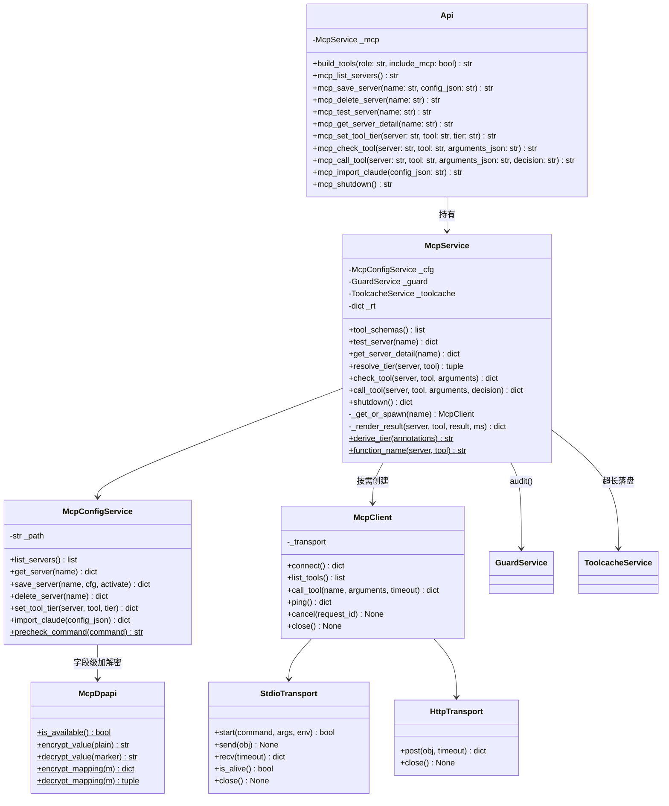
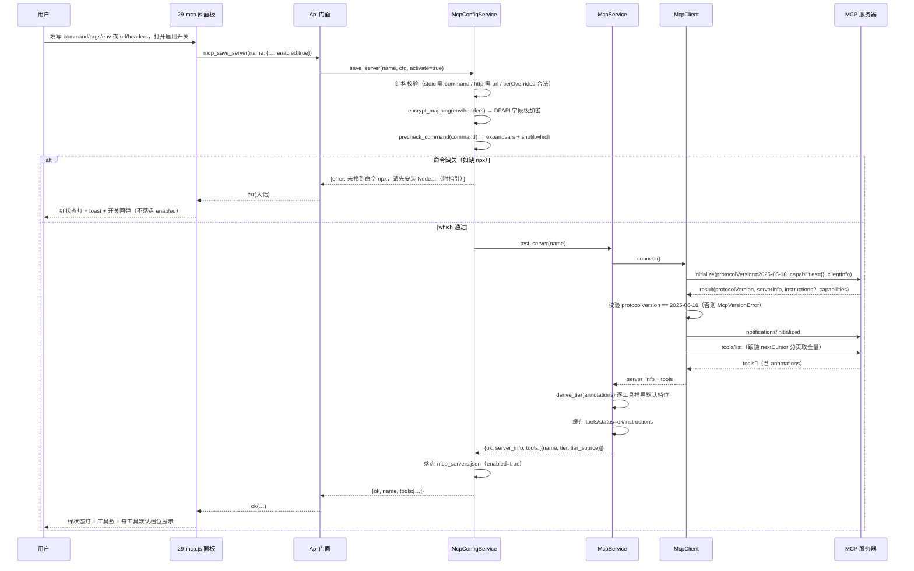
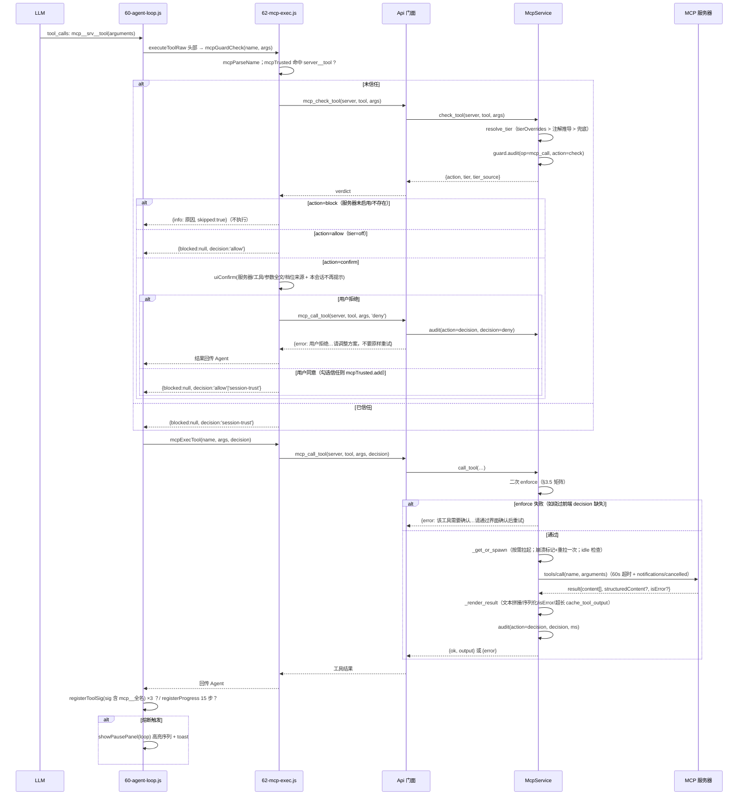
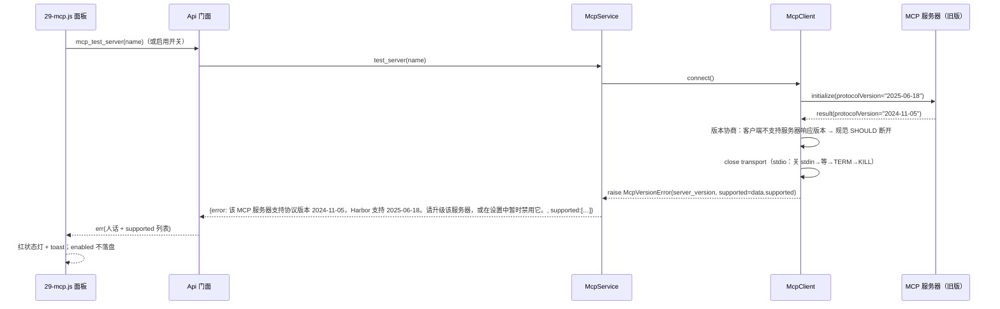
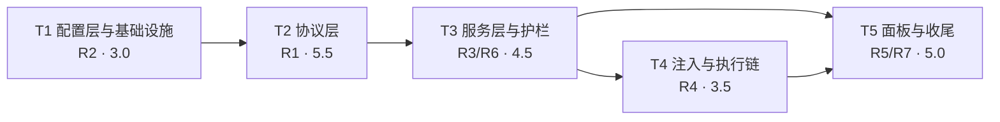

# Harbor v1.3「生态位」MCP 支持 · 增量架构设计与任务分解

**日期**：2026-10-15
**类型**：增量架构设计 + 实现任务分解（工程师实现依据）
**输入**：PRD v1.1（已冻结，`prd-glmchat-v13-mcp-2026-10-15.md`）、v1.2 架构文档与交付报告、代码库勘察结论
**范围**：R1 协议客户端核心 / R2 配置管理 / R3 分层护栏 / R4 工具注入执行 / R5 设置面板 / R6 生命周期 / R7 测试契约
**版本目标号**：APP_VERSION → 1.3.0（交付时改 VERSION 文件）；js_api 契约版本号 `API_VERSION='v1.0.0'` 不动

---

## 📌 TL;DR

- **一句话**：在 v1.2「信任版」地基上新增 6 个后端 `mcp_*` service + 10 个隐身 js_api 方法 + 2 个前端模块（29-mcp.js / 62-mcp-exec.js），把 MCP 工具面完整接进既有护栏哲学（三档确认 / 审计 / R4 熔断），**开放不以信任为代价**。
- **契约四红线的实现口径**：① `build_tools` 新增可选参数 `include_mcp=False`，默认路径与 legacy 逐字节一致（契约差分测试天然通过）；② 10 个新 js_api 方法全部进 `api.py` 的 `_V12_EXTRA` 隐身集合，`get_api_info` 输出零漂移；③ MCP 配置独立存 `~/.glm-chat/mcp_servers.json`（Claude 兼容结构），DPAPI 字段级加密只包 env 值 / header 值；④ 前端只改 `index.template.html` + `src/*.js`，新增 DOM id / class 只增不改。
- **实现路线**：零第三方依赖，手写最小 MCP 客户端（协议钉死 2025-06-18；stdio + Streamable HTTP 双传输；全请求超时 + 取消；sampling/elicitation/roots 一律 -32601）。
- **工作量**：21.5 人日（对齐 PRD 21 人日 ±缓冲；协议细节复杂化最坏 +1.5，缓冲在 T2）。
- **测试策略**：全打桩（stdio 用 `sys.executable` 临时桩脚本子进程、HTTP 用 mock urllib、DPAPI 用真实 crypt32 + 失败路径 monkeypatch）；新增 `tests/test_v13_mcp.py`，既有 66 passed 零回归。

---

## 1. 实现方案总览

### 1.1 模块挂点图

```
                        ┌────────────────────────────────────────────┐
                        │              前端（单脚本作用域）            │
                        │                                            │
                        │  60-agent-loop.js（Agent 主循环）           │
                        │    ├─ loadBackendTools → build_tools(role,  │
                        │    │     include_mcp=true)   ← R4 注入链     │
                        │    ├─ 路由过滤：mcp__ 工具 bypass（新增）     │
                        │    └─ registerToolSig/registerProgress       │
                        │         （R4 熔断自动覆盖 mcp__ 签名，零改动）│
                        │                                            │
                        │  25-tool-exec.js（executeToolRaw 头部）      │
                        │    └─ mcpGuardCheck → mcpExecTool（新挂点）  │
                        │                                            │
                        │  62-mcp-exec.js（新增）：护栏确认 + 执行分发  │
                        │  29-mcp.js（新增）：设置面板 / 服务器管理     │
                        │  26-guard.js / 18-toast.js：uiConfirm 复用   │
                        └──────────────────┬─────────────────────────┘
                                           │ pywebview 桥接（_V12_EXTRA 隐身）
                        ┌──────────────────▼─────────────────────────┐
                        │           backend/api.py（Api 门面）         │
                        │  build_tools(role, include_mcp=False)       │
                        │  mcp_* ×10（全部隐身）                       │
                        │  mcp_shutdown()（main.py atexit 注册）       │
                        └──────┬───────────────────────┬──────────────┘
                               │                       │
                   ┌───────────▼──────────┐   ┌────────▼─────────┐
                   │  mcp_service.py      │   │ tools_schema.py  │
                   │  生命周期/档位/审计/  │   │ build(role,      │
                   │  enforce/工具 schema │   │  ws_on,          │
                   └───┬──────┬───────┬───┘   │  mcp_tools=None) │
                       │      │       │       └──────────────────┘
        ┌──────────────▼─┐ ┌──▼──────────────┐ ┌▼──────────────┐
        │mcp_config_     │ │ mcp_client.py   │ │ guard_service  │
        │service.py      │ │ 协议层 2025-06-18│ │ （audit 复用） │
        │CRUD/导入/预检测│ │ 握手/分页/调用/  │ └────────────────┘
        └───┬────────────┘ │ 取消/超时/-32601 │
            │              └───┬─────────┬───┘
   ┌────────▼────────┐   ┌──────▼─────┐ ┌─▼──────────────┐
   │ mcp_dpapi.py    │   │ stdio 传输 │ │ HTTP 传输      │
   │ CryptProtectData│   │ 子进程+读线程│ │ urllib+SSE解析 │
   └─────────────────┘   └────────────┘ └────────────────┘
```

### 1.2 数据流一句话

- **启用链**：面板开关 → `mcp_save_server(enabled=true)` → 结构校验 → DPAPI 加密 env/headers → `shutil.which` 预检测 → 测试连接（握手 + tools/list + 档位推导）→ 全部通过才落盘 `enabled=true` 并缓存工具清单；任一步失败 → 红状态灯 + toast 人话 + 开关回弹，`enabled` 保持 false。
- **注入链**：`build_tools('full', include_mcp=True)` → `mcp_service.tool_schemas()`（仅 enabled 服务器，读缓存，零 IO）→ `tools_schema.build(..., mcp_tools=[...])` 追加在 full 工具列表尾部 → LLM 收到 `mcp__<server>__<tool>` 定义。
- **执行链**：Agent 循环 `executeToolRaw` → `mcpGuardCheck`（`mcp_check_tool` 定档 + `uiConfirm` 确认框）→ `mcpExecTool` → `mcp_call_tool`（后端二次 enforce + 审计 + 按需拉起 + tools/call + 结果渲染）→ 结果回传 Agent；R4 熔断由前端 `registerToolSig` 自动覆盖（签名含 `mcp__` 全名，零改动）。
- **不碰 config.json**：MCP 全部状态只进 `~/.glm-chat/mcp_servers.json`（配置）、进程内存（运行时）、`~/.glm-chat/audit_log.jsonl`（审计）。

---

## 2. 文件清单及相对路径

### 2.1 新增后端（6 个 service 级文件 + 1 个测试）

| 文件 | 职责 | 改动点 |
|---|---|---|
| `backend/services/mcp_dpapi.py` | DPAPI 字段级加密原语：`CryptProtectData`/`CryptUnprotectData`（ctypes，stdlib 零依赖，Python 3.10+，Windows 守卫） | 新增。只提供值级加解密与 `{'__enc__': 'dpapi:<base64>'}` 标记判定；非 Windows / 异常 → 明文存储 + 日志 |
| `backend/services/mcp_config_service.py` | `mcp_servers.json` 唯一读写者：Claude 兼容结构 CRUD、导入（同名冲突跳过并报告）、`tierOverrides` 持久化、启用时命令预检测（`shutil.which` + `expandvars` + PATHEXT） | 新增。所有 env 值 / header 值在落盘前经 `mcp_dpapi` 加密；读取时解密（失败按明文兜底 + 日志 + 告警标记） |
| `backend/services/mcp_transport_stdio.py` | stdio 传输：子进程拉起（`CREATE_NO_WINDOW`）、换行分隔 JSON 帧、读线程 + 队列、写锁串行化、规范关闭序列（关 stdin → 等 3s → terminate → 等 2s → kill） | 新增。stderr 独立 drain 线程防阻塞 |
| `backend/services/mcp_transport_http.py` | Streamable HTTP 传输：urllib POST、`MCP-Protocol-Version: 2025-06-18` 头、`Mcp-Session-Id` 会话管理（404 重连一次）、响应双解析（`application/json` 单帧 / `text/event-stream` SSE） | 新增 |
| `backend/services/mcp_client.py` | 协议层：`initialize`/`notifications/initialized` 握手、版本协商（只认 2025-06-18，不符抛 `McpVersionError` 带 `supported` 列表）、`tools/list` 游标分页、`tools/call`、`ping`、`notifications/cancelled` 取消、请求 id 关联、服务器发起的 sampling/elicitation/roots → 回复 `-32601` | 新增。构造参数注入 transport（可测性：协议单测用内存双向传输打桩） |
| `backend/services/mcp_service.py` | MCP 总服务：服务器运行时状态机（untested/ok/error/stale/disabled）、按需拉起 + 崩溃重拉一次 + 空闲回收（600s）、`notifications/tools/list_changed` 标记失效 + 后台刷新、注解推导档位、`tierOverrides` 解析、护栏判定接入（复用 `GuardService.audit`）、后端二次 enforce、结果渲染（文本拼接 / structuredContent 序列化 / isError / 超长截断落盘 `ToolcacheService`）、`mcp__` 函数名净化、关闭全部 | 新增。被 `Api` 门面持有 |
| `tests/test_v13_mcp.py` | R7 专项：协议帧单测（内存桩 + 真实 stdio 桩脚本 + HTTP mock）、DPAPI 往返、配置 CRUD/导入/预检测、档位推导与 enforce 矩阵、审计落盘、命名净化、`build_tools` 契约回归、`get_api_info` 隐身断言、config.json 不污染断言 | 新增（约 40+ 用例） |

### 2.2 修改后端（3 个 + 1 个入口 + 1 个版本文件）

| 文件 | 改动点 |
|---|---|
| `backend/api.py` | ① `_V12_EXTRA` frozenset 增加 10 个 `mcp_*` 方法名（L37，集合名不变，注释更新为 v1.2/v1.3）；② `Api.__init__` 装配 `McpService(self._guard, self._toolcache)`；③ `build_tools(self, role='full', include_mcp=False)`：`include_mcp and role=='full'` 时取 `self._mcp.tool_schemas()` 传入 `tools_schema.build`；④ 新增 10 个 `mcp_*` 公开方法（§3.4）；⑤ `delete_path`/`kill_process` 既有 enforce 挂点不动 |
| `backend/tools_schema.py` | `build(role='full', ws_on=True, mcp_tools=None)`：仅当 `role=='full' and mcp_tools` 时在列表尾部 `tools += mcp_tools`。`mcp_tools=None`（默认）→ 与 legacy 逐字节一致 |
| `backend/paths.py` | 新增 `MCP_SERVERS_FILE = os.path.join(CONFIG_DIR, 'mcp_servers.json')`（不新增目录，文件级常量同 guard.json 口径） |
| `main.py` | `atexit.register(api.mcp_shutdown)`（窗口关闭 / 进程退出时关停全部 stdio 子进程；与 `webview.start()` 返回值无关，测试环境同样生效） |
| `VERSION` | 交付时 `1.2.2 → 1.3.0`（APP_VERSION 单一数据源，`update_service._load_app_version()` 动态读取，代码零改动）——**由交付批次执行，不在 T1–T5 内** |

### 2.3 新增前端（2 个模块）

| 文件 | 职责 |
|---|---|
| `frontend/src/29-mcp.js` | 设置面板「MCP 服务器」区块：服务器列表（状态灯 / 传输 / 工具数 / 开关 / 编辑 / 删除 / 测试连接）、添加编辑表单（stdio: command+args+env；HTTP: url+headers）、逐工具档位覆盖 UI、instructions 展示（标注「仅展示，不注入系统提示」）、导入 Claude 配置模态、env 明文风险与 DPAPI 说明、运行时错误 toast。DOM 全部动态模态创建（复用 `_modalRoot`），静态仅增 `mcpServerList` / `mcpAddBtn` / `mcpImportBtn` / `mcpRefreshBtn` 四个 id 与 `mcp-*` CSS 类 |
| `frontend/src/62-mcp-exec.js` | Agent 循环 MCP 分发：`mcpParseName`（`mcp__server__tool` 解析）、`mcpGuardCheck`（调 `mcp_check_tool` + 复用 `uiConfirm` 确认框 + `mcpTrusted` 会话信任态 + deny 路径落审计）、`mcpExecTool`（调 `mcp_call_tool`，decision 透传）。异常 → fail-closed（外部代码执行不设 fail-open） |

### 2.4 修改前端（5 个既有模块 + 模板）

| 文件 | 改动点 |
|---|---|
| `frontend/src/25-tool-exec.js` | `executeToolRaw` 头部在 `guardCheckTool` 之后插入 MCP 分支：`name.startsWith('mcp__')` → `mcpGuardCheck`（返回 `{blocked}` 直接作为工具结果；否则记 `mcpDecision`）；函数体末尾「未知工具」前插入 `mcpExecTool(name, args, mcpDecision)` 分发 |
| `frontend/src/60-agent-loop.js` | ① `loadBackendTools(mode)` 内 `callApi('build_tools', [role, mode === 'full'])`（full 档才带 MCP 工具，与 Q3 裁决一致）；② 两处路由过滤（L54–57 与 L102–105）放行 `t.function.name.startsWith('mcp__')`（用户显式启用的外部工具不参与域路由裁剪）；其余不动（R4 熔断签名天然含 `mcp__` 全名） |
| `frontend/src/00-state.js` | 新增 `const mcpTrusted = new Set()`（进程内信任态，键 `server__tool`；切会话**不**清空——比 v1.2 guardTrusted 更保守）+ `let mcpServers = []`（面板缓存） |
| `frontend/src/80-utils.js` | `buildToolLabel` switch 前增 `mcp__` 前缀分支：`🔌 MCP <server> · <tool>`（Agent 流里可辨识外部工具） |
| `frontend/index.template.html` | 设置面板新增「MCP 服务器」`set-block`（标题 + 说明 hint + 工具栏 + `mcpServerList` 容器）；CSS 纯新增（`mcp-dot.ok/.err/.off/.stale`、`mcp-row`、`mcp-tier-tag` 等）。既有 40 DOM id / 13 onclick / 43 callApi / 39 CSS 类 / 21 主题变量零改动 |
| `frontend/src/28-audit-viewer.js` | 可选小改：`_auditDetailText` 增 `if (d.server) return 'MCP ' + d.server + ' · ' + (d.tool || '?')` 分支，让 `op=mcp_call` 记录显示更可读（不改既有键路径；不改则回落通用 `k=v` 渲染，功能不受影响） |

---

## 3. 数据结构与接口设计

### 3.1 `mcp_servers.json` 存储结构（Claude 兼容 + 扩展键 + DPAPI 标记）

```json
{
  "mcpServers": {
    "fs-local": {
      "command": "npx",
      "args": ["-y", "@modelcontextprotocol/server-filesystem", "C:\\Work"],
      "env": { "API_TOKEN": { "__enc__": "dp64:AQAAANCMnd8BFdERjHoAA..." } },
      "enabled": false,
      "tierOverrides": { "read_file": "session" }
    },
    "remote-api": {
      "url": "https://mcp.example.com/mcp",
      "headers": { "Authorization": { "__enc__": "dp64:AQAAANCMnd8BFdERjHoAA..." } },
      "enabled": false,
      "tierOverrides": {}
    }
  }
}
```

**结构规则**：

| 规则 | 说明 |
|---|---|
| Claude 兼容 | `mcpServers.<name>.{command,args,env}`（stdio）/ `{url,headers}`（HTTP）——从 README 抄来的配置原样可用 |
| 扩展键 | `enabled`（bool，默认 false，opt-in）、`tierOverrides`（`{tool: always\|session\|off}`）——Claude 忽略它们，互不干扰 |
| DPAPI 字段级 | **只加密 env 值与 header 值**：加密值写成单键标记对象 `{"__enc__": "dpapi:<base64>"}`；`command`/`args`/url/键名/服务器名保持明文（可读、可手改、导入不受影响） |
| 明文容忍 | 值若是普通字符串（手改 / Claude 导入原样）→ 按明文使用，下次保存时自动加密；标记对象解密失败（换机器 / 换 Windows 用户）→ 按内层串兜底 + 日志 + 面板告警「密钥解密失败，请重新填写」 |
| 服务器名 | 原样保留作 key（大小写敏感）；保存时校验净化后函数名冲突（§3.6） |

### 3.2 类图



### 3.3 关键类签名（签名级）

```python
# backend/services/mcp_dpapi.py —— DPAPI 字段级加密（stdlib only）
ENC_PREFIX = 'dpapi:'
def is_available() -> bool: ...
def encrypt_value(plain: str) -> str: ...          # 返回 ENC_PREFIX+base64；不可用/异常 → 原样返回并记日志
def decrypt_value(marker: str) -> str: ...         # 非标记 → 原样；标记 → 解密；失败 → 记日志 + 返回内层串（明文兜底）
def encrypt_mapping(m: dict) -> dict: ...          # {k: encrypt_value(v)}，仅值
def decrypt_mapping(m: dict) -> tuple[dict, list]: ...   # (解密后 dict, 失败键告警列表)

# backend/services/mcp_config_service.py
class McpConfigService:
    def __init__(self, path: str = None): ...
    def list_servers(self) -> list: ...            # [{name, transport, enabled}]（无密文，面板列表用）
    def get_server(self, name) -> dict | None: ... # 解密后的运行视图（env/headers 明文，编辑器回显用）
    def save_server(self, name: str, cfg: dict, activate: bool = False) -> dict: ...
        # 结构校验（stdio 必须有 command / http 必须有 http(s) url / tierOverrides 合法值）
        # env、headers 值加密后落盘；activate=True（enabled false→true）时先 precheck_command，
        # 失败返回 {error: 人话} 且不落盘 enabled=true
    def delete_server(self, name) -> dict: ...
    def set_tool_tier(self, server: str, tool: str, tier: str) -> dict: ...   # 写 tierOverrides
    def import_claude(self, config_json: str) -> dict: ...
        # 解析 {"mcpServers": {...}}；逐条：type=="sse" → skipped(不受支持)；
        # 同名（已存在）→ skipped(冲突)；其余按传输类型入库 enabled=false；
        # 返回 {ok, imported:[...], skipped:[{name, reason}], total}
    @staticmethod
    def precheck_command(command: str) -> str | None: ...
        # os.path.expandvars → 含路径分隔符则查文件存在+可执行；否则 shutil.which（PATHEXT 覆盖 .cmd/.bat）；
        # None=通过；否则返回人话（缺什么 + uv/Node 官网安装指引）
```

```python
# backend/services/mcp_transport_stdio.py
class StdioTransport:
    def __init__(self, logger=None): ...
    def start(self, command: str, args: list, env: dict) -> bool: ...
        # subprocess.Popen([command]+args, stdin=PIPE, stdout=PIPE, stderr=PIPE,
        #                  creationflags=CREATE_NO_WINDOW, env={**os.environ, **env})
        # bytes 管道 + UTF-8；读线程按行切帧入队列；stderr drain 线程防阻塞
    def send(self, obj: dict) -> None: ...         # json.dumps+'\n'，写锁串行化（并发 tools/call 安全）
    def recv(self, timeout: float) -> dict | None: ...   # 队列取一帧；None=超时
    def is_alive(self) -> bool: ...                # poll() is None
    def close(self) -> None: ...                   # 关 stdin → 等 3s → terminate → 等 2s → kill（规范序列）

# backend/services/mcp_transport_http.py
class HttpTransport:
    def __init__(self, url: str, headers: dict, logger=None): ...
    def post(self, obj: dict, timeout: float) -> dict | None: ...
        # urllib.request；头：Content-Type/ Accept(json+sse)/ MCP-Protocol-Version/ 用户 headers/ Mcp-Session-Id
        # 响应：application/json → 单帧；text/event-stream → 聚首条 data: JSON
        # HTTP 404 且曾 initialize → 清 session 重连一次（由 client 层驱动）
    def close(self) -> None: ...
```

```python
# backend/services/mcp_client.py
MCP_PROTOCOL_VERSION = '2025-06-18'
class McpVersionError(Exception):
    def __init__(self, server_version: str, supported: list): ...
class McpProtocolError(Exception):
    def __init__(self, code: int, message: str, data=None): ...

class McpClient:
    def __init__(self, transport, logger=None): ...      # transport 注入：协议单测可传内存双向桩
    def connect(self) -> dict: ...
        # initialize{protocolVersion, capabilities:{}, clientInfo:{name,version}}
        # → 校验响应 protocolVersion == MCP_PROTOCOL_VERSION，否则 close + raise McpVersionError(supported=data.supported)
        # → notifications/initialized；返回 serverInfo/instructions
    def list_tools(self) -> list: ...                    # tools/list 跟随 nextCursor 直到为空；聚合 tools[]
    def call_tool(self, name: str, arguments: dict, timeout: float) -> dict: ...   # tools/call；超时发 notifications/cancelled
    def ping(self) -> dict: ...
    def cancel(self, request_id) -> None: ...            # notifications/cancelled {requestId, reason}
    def close(self) -> None: ...
    # 内部：_request(method, params, timeout) → result（id 自增，异常映射 McpProtocolError）
    #        _notify(method, params)
    # 收到带 id 的服务器请求（sampling/createMessage、elicitation/create、roots/list）
    #   → 回复 {"jsonrpc":"2.0","id":id,"error":{"code":-32601,"message":"Method not found"}}
```

```python
# backend/services/mcp_service.py
IDLE_TIMEOUT = 600            # stdio 空闲回收（秒）
CALL_TIMEOUT = 60             # tools/call 固定阈值（PRD 假设①）
CONNECT_TIMEOUT = 30          # 握手/冷启（npx 首次下载依赖）
LIST_TIMEOUT = 15             # tools/list
OUTPUT_CACHE_LIMIT = 20000    # 超长输出截断落盘阈值（字符）

class McpService:
    def __init__(self, config: McpConfigService, guard: GuardService, toolcache: ToolcacheService, logger=None): ...
    # 运行时 _rt[name] = {client, transport, tools, status, last_error,
    #                     instructions, server_info, last_used, lock, spawned_once}
    def tool_schemas(self) -> list: ...
        # enabled 服务器 → [{'type':'function','function':{'name': function_name(s,t),
        #   'description': f'[MCP·{server}] {desc or tool}', 'parameters': inputSchema or {...}}}]
        # 无 enabled → []；stale/error → 跳过（后台刷新）+ 该服务器不入列表
    def test_server(self, name) -> dict: ...
        # 连接 + tools/list + derive_tier 推导；不落 enabled；返回 {ok, server_info,
        # protocol_version, tools:[{name, description, annotations, tier, tier_source}], instructions, error?}
    def get_server_detail(self, name) -> dict: ...       # 同上 + status + last_error + tierOverrides 现值
    def resolve_tier(self, server: str, tool: str) -> tuple[str, str]: ...   # (tier, 'override'|'annotation'|'default')
    def check_tool(self, server: str, tool: str, arguments: dict) -> dict: ...
        # resolve_tier → off=allow / always|session=confirm；服务器不存在或 disabled → block；
        # 工具未缓存 → tier 按最保守 always + confirm（附提示，由 call_tool 最终验证存在性）
        # 落审计 op=mcp_call action=check
    def call_tool(self, server: str, tool: str, arguments: dict, decision: str = 'deny') -> dict: ...
        # 二次 enforce 矩阵见 §3.5；拒绝 → audit(block) + {error: 人话}
        # 通过 → _get_or_spawn（按需拉起 / 崩溃重拉一次 / idle 回收检查）→ tools/call
        # → _render_result（文本拼接 / structuredContent 序列化 / isError / 超长 cache_tool_output）
        # → audit(action=decision, decision=...)
    def shutdown(self) -> dict: ...                      # 逆序关闭全部传输
    def _get_or_spawn(self, name) -> McpClient | None: ...
        # 双检锁；进程已死 → 标记 + 重拉一次，仍失败 → status=error（红状态灯人话）
    @staticmethod
    def derive_tier(annotations: dict) -> str: ...
        # destructiveHint true → 'always'；readOnlyHint true 且非 destructive → 'session'；其余 → 'always'
    @staticmethod
    def function_name(server: str, tool: str) -> str: ...   # mcp__<s>__<t> 净化（§3.6）
```

### 3.4 js_api 新方法完整清单（10 个，全部进 `_V12_EXTRA`）

| # | 方法 | 参数 | 返回（JSON 字符串，`ok()`/`err()` 协议） | 需求 |
|---|---|---|---|---|
| 1 | `mcp_list_servers()` | — | `{ok, servers:[{name, transport, enabled, status, tool_count, last_error}]}`；`status ∈ ok/error/stale/disabled` | R5 |
| 2 | `mcp_save_server(name, config_json)` | `config_json`：`{command?, args?, env?, url?, headers?, enabled?, tierOverrides?}` | `{ok, name}`；校验/预检测失败 `{error: 人话}`（enabled 不落盘） | R2/R6 |
| 3 | `mcp_delete_server(name)` | — | `{ok}` / `{error}`（不存在） | R2 |
| 4 | `mcp_test_server(name)` | — | `{ok, server_info, protocol_version, instructions, tools:[{name, description, annotations, tier, tier_source}]}` / `{error: 人话+supported?}` | R1/R2 |
| 5 | `mcp_get_server_detail(name)` | — | `{ok, ..., config(解密视图含 env/headers), tools(含现档位), instructions, status, last_error}` / `{error}` | R5 |
| 6 | `mcp_set_tool_tier(server, tool, tier)` | `tier ∈ always/session/off` | `{ok}` / `{error}`（服务器或 tier 非法） | R3 |
| 7 | `mcp_check_tool(server, tool, arguments_json='{}')` | — | `{ok, action: allow/confirm/block, tier, tier_source, reason?}`；落审计 check | R3 |
| 8 | `mcp_call_tool(server, tool, arguments_json='{}', decision='deny')` | `decision ∈ deny/allow/session-trust`，**默认 deny** | `{ok, output}` / `{error}` / `{info, skipped}`（拒绝）；落审计 decision/block | R3/R4 |
| 9 | `mcp_import_claude(config_json)` | claude_desktop_config.json 全文 | `{ok, imported:[...], skipped:[{name, reason}], total}` | R2 |
| 10 | `mcp_shutdown()` | — | `{ok, closed: n}`（main.py atexit + 测试用） | R6 |

**`_V12_EXTRA` 扩充**（api.py L37，集合名不变）：

```python
_V12_EXTRA = frozenset({
    'guard_get_config', 'guard_save_config', 'guard_check', 'guard_audit', 'get_audit_log',
    'check_update', 'start_update_download', 'get_update_progress', 'apply_update',
    'test_provider_endpoint',
    # v1.3 MCP（10 个，同样对 get_api_info 隐身）
    'mcp_list_servers', 'mcp_save_server', 'mcp_delete_server', 'mcp_test_server',
    'mcp_get_server_detail', 'mcp_set_tool_tier', 'mcp_check_tool', 'mcp_call_tool',
    'mcp_import_claude', 'mcp_shutdown',
})
```

### 3.5 档位推导与后端二次 enforce 矩阵

**推导规则**（注解不可信，只推导默认档位，最宽到 session，永不放宽到 off）：

```python
@staticmethod
def derive_tier(annotations):
    a = annotations or {}
    if a.get('destructiveHint') is True:
        return 'always'
    if a.get('readOnlyHint') is True:
        return 'session'
    return 'always'      # 无注解 → 保守每次确认
```

优先级：`tierOverrides`（用户覆盖，`'override'`）> 注解推导（`'annotation'`）> 兜底（`'default'`，工具未缓存时按 always）。

**`mcp_call_tool` 二次 enforce 矩阵**（防前端绕过；decision 缺失/未知一律按 deny 处理，tier=off 除外——off 是用户显式关闭确认）：

| 档位 ＼ decision | `deny` | `allow` / `session-trust` | 缺失/未知 |
|---|---|---|---|
| `off` | 拒绝（audit deny） | 执行 | 执行（无需确认） |
| `session` | 拒绝（audit deny） | 执行 | **拒绝**（audit block，人话「该工具需要确认…」） |
| `always` | 拒绝（audit deny） | 执行 | **拒绝**（audit block，同上） |

### 3.6 `mcp__<server>__<tool>` 命名净化规则

```python
@staticmethod
def function_name(server: str, tool: str) -> str:
    s = re.sub(r'[^A-Za-z0-9_-]', '_', str(server or '')).strip('_') or 'server'
    t = re.sub(r'[^A-Za-z0-9_-]', '_', str(tool or '')).strip('_') or 'tool'
    name = 'mcp__%s__%s' % (s, t)
    if len(name) > 64:                      # OpenAI/GLM 函数名上限
        h = hashlib.sha256(name.encode('utf-8')).hexdigest()[:6]
        name = name[:57] + '_' + h
    return name
```

- 字符集 `[A-Za-z0-9_-]`（GLM/OpenAI 函数名合法）；非法字符 → `_`；空 → 占位。
- 超 64 字符截断 + 6 位 hash 尾（保唯一）；同会话内净化后重名 → 追加 `_2`、`_3`（`tool_schemas()` 生成时去重，保证 LLM 看到的函数名唯一）。
- 服务器名本身大小写敏感保留（配置 key），净化仅作用于函数名生成。

---

## 4. 关键流程时序图

### 4.1 服务器启用流程（R2/R5/R6，含环境预检测与测试连接）



### 4.2 MCP 工具调用护栏流程（R3，含后端二次 enforce 与 R4 熔断接入）



### 4.3 版本不匹配错误流（R1）



---

## 5. 任务列表（T1–T5，按实现顺序）

> 每批可独立测试；工作量合计 **21.5 人日**（PRD 21 人日 + 0.5 缓冲；协议细节复杂化最坏 T2 +1.5）。
> 环境：pytest 用 `C:\Users\陈\.workbuddy\binaries\python\envs\default\Scripts\python.exe`；前端构建 `C:\Users\陈\.workbuddy\binaries\node\versions\22.22.2-6\node.exe frontend/build.js`。

| 任务 | 名称 | 源文件 | 依赖 | 需求 | 优先级 | 工作量 |
|---|---|---|---|---|---|---|
| T1 | 配置层与项目基础设施 | `backend/paths.py`(改)、`backend/services/mcp_dpapi.py`(新)、`backend/services/mcp_config_service.py`(新)、`tests/test_v13_mcp.py`(新·骨架+配置/DPAPI 用例)、`VERSION`(不改·交付批) | — | R2、R7(部分)、裁决 Q1 | P0 | 3.0 |
| T2 | 协议层（手写最小客户端） | `backend/services/mcp_transport_stdio.py`(新)、`backend/services/mcp_transport_http.py`(新)、`backend/services/mcp_client.py`(新)、`tests/test_v13_mcp.py`(协议用例) | T1 | R1、R7(部分) | P0 | 5.5 |
| T3 | 服务层与护栏接入 | `backend/services/mcp_service.py`(新)、`backend/api.py`(改·10 方法+build_tools+装配)、`main.py`(改·atexit)、`tests/test_v13_mcp.py`(护栏/enforce/审计/生命周期用例) | T2 | R3、R6(部分)、R7(部分) | P0 | 4.5 |
| T4 | 工具注入与执行链 | `backend/tools_schema.py`(改)、`frontend/src/62-mcp-exec.js`(新)、`frontend/src/25-tool-exec.js`(改)、`frontend/src/60-agent-loop.js`(改)、`frontend/src/00-state.js`(改)、`frontend/src/80-utils.js`(改)、`tests/test_v13_mcp.py`(注入/契约回归用例) | T3 | R4、R7(契约) | P0 | 3.5 |
| T5 | 面板层与联调收尾 | `frontend/src/29-mcp.js`(新)、`frontend/index.template.html`(改)、`frontend/src/28-audit-viewer.js`(改·可选小优化)、`tests/test_v13_mcp.py`(全量回归)、UI 契约校验、冒烟清单 | T3、T4 | R5、R6(引导联调)、R7(回归) | P0(P1 体验) | 5.0 |

### T1 配置层与项目基础设施（3.0 人日）

- **内容**：`paths.py` 加 `MCP_SERVERS_FILE`；`mcp_dpapi.py`（ctypes `CryptProtectData`/`CryptUnprotectData`，`WinDLL` 守卫，非 Windows/异常 → 明文 + 日志，标记 `{'__enc__': 'dp64:<base64>'}`，解密失败明文兜底 + 告警列表）；`mcp_config_service.py`（mcp_servers.json 读写、Claude 兼容校验、`import_claude` 同名冲突跳过 + SSE 条目明确跳过、`tierOverrides` 持久化、`precheck_command` = expandvars + which/PATHEXT + 安装指引人话）；测试骨架与配置/DPAPI 用例。
- **验收（PRD R2 Given/When/Then）**：粘贴 Claude 格式配置保存 → 列表出现且可启用；导入 3 服务器 claude_desktop_config.json → 全部出现（默认 enabled=false）且冲突项有明确提示；保存配置后 config.json 内容逐字节不变；env/header 值落盘为加密标记、键名明文、command/args 明文；DPAPI 解密失败兜底不抛异常。
- **独立测试**：`pytest tests/test_v13_mcp.py -k config or dpapi`。

### T2 协议层（5.5 人日）

- **内容**：`mcp_transport_stdio.py`（Popen + 读线程 + stderr drain + 换行帧 + 写锁 + 规范关闭序列）；`mcp_transport_http.py`（urllib + `MCP-Protocol-Version` 头 + `Mcp-Session-Id` + JSON/SSE 双解析）；`mcp_client.py`（握手、版本钉死 2025-06-18、游标分页、tools/call、ping、取消、-32601 拒绝 sampling/elicitation/roots、超时常量）；协议单测（内存双向桩打 fake server + `sys.executable` 临时桩脚本真实子进程 + HTTP mock urllib 断言头与 SSE 解析）。
- **验收（PRD R1 Given/When/Then）**：stdio 测试连接完成握手并返回工具清单与服务器信息；工具超一页跟随 nextCursor 取全量；仅支持旧版 → 连接失败且文案含 supported 列表；调用超时 → 发送取消并返回人话；HTTP 任一请求带 `MCP-Protocol-Version` 头。
- **独立测试**：`pytest tests/test_v13_mcp.py -k protocol or stdio or http`。

### T3 服务层与护栏接入（4.5 人日）

- **内容**：`mcp_service.py`（运行时状态机、按需拉起、崩溃重拉一次、idle 600s 回收、list_changed 标记失效 + 后台刷新、`derive_tier`、`resolve_tier`、`check_tool`/`call_tool` 含 enforce 矩阵与审计 `op=mcp_call`、`_render_result` 截断落盘、`function_name` 净化、`tool_schemas`、`shutdown`）；`api.py`（装配 + 10 个隐身方法 + `build_tools(role, include_mcp=False)`）；`main.py`（atexit 注册 `mcp_shutdown`）；护栏测试（档位推导 / enforce 矩阵全组合 / 审计落盘字段 / 崩溃重拉 / idle 回收用短超时注入）。
- **验收（PRD R3 Given/When/Then）**：新服务器无注解工具 → 每次弹确认；readOnlyHint 工具同会话第 2 次不再确认（前端信任态）；用户拒绝 → 不执行且向 Agent 返回拒绝原因；绕过前端直接调后端档位 always → 后端拒绝；循环同一 MCP 工具同参数第 3 次 → R4 熔断（T4 联调断言，签名天然含 mcp__ 名）。
- **独立测试**：`pytest tests/test_v13_mcp.py -k guard or service or enforce or audit`；`pytest tests/ -q`（既有 66 零回归）。

### T4 工具注入与执行链（3.5 人日）

- **内容**：`tools_schema.py` 加 `mcp_tools` 尾参；前端 `62-mcp-exec.js`（`mcpParseName`/`mcpGuardCheck`/`mcpExecTool`，复用 `uiConfirm` + `mcpTrusted`，fail-closed）；`25-tool-exec.js` 挂点；`60-agent-loop.js`（`build_tools(role, mode==='full')` + 两处路由过滤放行 `mcp__`）；`00-state.js` 新状态；`80-utils.js` 标签；契约回归用例。
- **验收（PRD R4 Given/When/Then）**：无启用服务器时 `build_tools(role)` 与 v1.2 逐字节一致（差分门）；启用含 2 工具的服务器 → LLM 收到 2 个 `mcp__` 定义且调用成功回传；structuredContent 序列化为文本回传；超长输出截断落盘可 `read_more`；错误人话映射五类（握手失败/版本不匹配/超时/崩溃/工具不存在）。
- **独立测试**：`pytest tests/test_v13_mcp.py -k tools or contract`；`node frontend/build.js` 成功（34 模块）。

### T5 面板层与联调收尾（5.0 人日）

- **内容**：`29-mcp.js`（列表/表单/详情/档位覆盖/导入模态/instructions 展示/状态灯/toast）；`index.template.html` MCP set-block + CSS（纯新增）；`28-audit-viewer.js` 可选小优化；全量回归 + UI 契约 + 冒烟六步清单（导入→启用→确认→拒绝→审计→熔断）。
- **验收（PRD R5 Given/When/Then）**：启用后面板显示工具数与每工具当前档位；启动失败 → 红状态灯 + toast 明示；改档位保存 → 下次调用按新档位；`check_contract.py` PASS（新增 id/class 只增不改）；审计查看器可见 `op=mcp_call` 流水；R6 缺 npx 启用时提示缺什么去哪装。
- **独立测试**：`python deliverables/design/check_contract.py`；`pytest tests/ -q` 全绿；`node frontend/build.js` 幂等。

---

## 6. 任务依赖图



- 关键路径：T1 → T2 → T3 → T4 → T5（协议正确性是全局前置）。
- T5 的 `29-mcp.js` 可在 T3 接口冻结后与 T4 并行开发（打后端 mock），最终联调在 T4 完成后。
- R7 测试用例内嵌各任务（T1 骨架 → T2/T3/T4 专项 → T5 全量回归），不单列任务。

---

## 7. 共享知识（跨文件约定，工程师必读）

1. **js_api 契约**：10 个新方法全部在 `_V12_EXTRA`；`get_api_info` 输出逐字节不变；`build_tools(role='full', include_mcp=False)` 第二参默认 False；`api_methods.log`（main.py 启动日志）会含新方法名——那是运行日志不是契约，属预期。
2. **config.json 零接触**：MCP 一切状态只进 `mcp_servers.json` / 进程内存 / `audit_log.jsonl`；契约测试比对 config.json 内容，任何 MCP 操作不得触发 config 写入。
3. **命名净化**：`mcp__<server>__<tool>`；净化 `[^A-Za-z0-9_-]→'_'`；≤64 字符（截断 + hash6 尾）；`tool_schemas()` 内去重（`_2` 后缀）；前端 `mcpParseName` 用 `/^mcp__(.+?)__(.+)$/` 解析（server 段不允许含 `__` 的歧义由净化规则消除）。
4. **错误人话映射表**（后端 `mcp_service`/`mcp_client` 统一出口，前端 `62-mcp-exec.js` 透传不二次加工）：

   | 场景 | 人话文案（含可行操作） |
   |---|---|
   | 握手失败/进程起不来 | 「无法启动 MCP 服务器（命令：x）。请确认该命令已安装且可在命令行运行。」 |
   | 缺运行时（which 失败） | 「未找到命令 npx（或 uvx）。请先安装 Node.js（https://nodejs.org）/ uv（https://astral.sh/uv）后重试。」 |
   | 版本不匹配 | 「该 MCP 服务器支持协议版本 X，Harbor 支持 2025-06-18。请升级该服务器，或在设置中暂时禁用它。」+ supported 列表 |
   | 调用超时 | 「MCP 工具调用超时（60 秒），已发送取消。可重试或确认服务器是否卡死。」 |
   | 服务器崩溃 | 「MCP 服务器进程已崩溃（退出码 N），已自动重拉一次；仍失败请检查服务器后重试。」 |
   | 工具不存在（-32602） | 「服务器未提供该工具（可能已升级/卸载）。可在设置中刷新工具列表后重试。」 |
   | 未连接/未启用 | 「MCP 服务器未连接（可能已禁用或崩溃），请先在设置中测试连接。」 |
   | 需确认被拒（enforce） | 「该工具需要确认（档位 always/session）。请通过界面确认后重试，不要绕过确认流程。」 |
   | 用户拒绝（Agent 可见） | 「用户拒绝了本次 MCP 工具调用（server · tool）。请调整方案或询问用户意图，不要原样重试。」 |
   | sampling/elicitation/roots | 「服务器发起了不受支持的请求（sampling/elicitation/roots），v1.3 不支持，已按规范回复方法未找到。」 |

5. **超时阈值**（常量集中在 `mcp_client.py`/`mcp_service.py`）：握手/冷启 30s、tools/list 15s、tools/call 60s（固定，PRD 假设①）、ping 10s、HTTP 读 60s、stdio idle 回收 600s、关闭序列 3s/2s。**前端 `callApi` 调 `mcp_call_tool`/`mcp_test_server` 必须传第三参 `timeoutMs=90000`**（默认 60s 不够：后端 60s + 拉起 + 余量）。
6. **审计约定**：仅 `op='mcp_call'`（不记服务器启用/停用事件——那进 logs）；detail 键 `{server, tool, args(摘要≤200字符), tier, tier_source}`（**禁用 `path`/`name`/`head` 键**，避免审计查看器误渲染）；action ∈ `check`/`decision`/`block`；decision ∈ `allow`/`deny`/`session-trust`。复用 `GuardService.audit()`，时间戳格式与 v1.2 一致。
7. **R4 熔断接入点**：前端 `36-cost-defense.js` **零改动**——`registerToolSig(sig)` 的 sig 由 `toolCalls.map(tc => [tc.name, tc.argsStr])` 生成，天然含 `mcp__` 全名，×3 熔断与 15 步无进展自动覆盖；`showPausePanel` 高亮序列自动显示 MCP 工具名。62-mcp-exec.js **不得**自行计数。
8. **确认框复用约定**（对齐 26-guard.js）：`uiConfirm({title, body, danger, okText, checkboxLabel})`（18-toast.js）；信任态 `mcpTrusted`（00-state.js，键 `server__tool`，进程内有效、切会话不清空——比 guardTrusted 更保守）；拒绝走 `mcp_call_tool(decision='deny')` 落审计并取 Agent 可见人话；deny 结果用 `{info, skipped:true}` 形状（前端渲染 ⊘）。
9. **档位语义**：`off`=不确认直接放行；`session`=会话内首次确认（信任态命中放行）；`always`=每次确认（勾选信任后按 session 放行）。注解只推导默认（最宽 session），`tierOverrides` 永远优先；注解不可信，任何情况不因注解自动关闭确认。
10. **instructions 处置**（裁决 Q4）：`mcp_get_server_detail`/`mcp_test_server` 返回 `instructions` 供面板展示（标注「仅展示，不会注入系统提示」）；**禁止**进入任何 prompt 组装路径；逐服务器 opt-in 注入开关留 v1.3.x。
11. **DPAPI 边界**：只加密 env 值 / header 值；command/args/url/键名/服务器名明文；解密失败 → 明文兜底 + 日志 + 面板告警；编辑器回显解密值（本地单用户应用，与 config.json 的 apiKey 同信任级）；保存时空值 env 条目=删除该键。
12. **前端构建铁律**：只改 `index.template.html` + `src/*.js`；`node frontend/build.js` 重建；新模块 `29-mcp.js`（面板）/`62-mcp-exec.js`（执行）按文件名排序插入（29 在 28 后、30 前；62 在 60 后、65 前）；单脚本作用域，函数声明提升保证 25 可调用 62 的定义。
13. **Python 3.10+ / Windows-only**：禁 3.11+ 特性（tomllib/ExceptionGroup/Self）；`ctypes.windll` 用 `hasattr` 守卫；stdio 用 `creationflags=CREATE_NO_WINDOW` 防控制台弹窗；路径比较大小写不敏感口径同 guard_service。
14. **返回协议**：统一 `errors.py` 的 `ok()/err()`；MCP 工具结果三形态：`{ok, output}`（成功）、`{error}`（失败/拒绝 enforce）、`{info, skipped}`（用户拒绝/不可用拦截）；`output` 键 >20000 字符走后端截断落盘（`cache_tool_output` + read_more 提示），前端历史截断逻辑（60-agent-loop 既有 `parsed.output > 20000`）天然兼容。

---

## 8. 待明确事项（实现中如需主理人裁决）

1. **tools/call 固定 60s 超时**：慢工具（大型构建/长任务型 MCP 服务器）可能误伤。PRD 假设①已接受 v1.3 固定阈值；建议确认「固定 60s + v1.3.x 再开放每工具可配」，如同意则无需额外设计（默认采纳）。
2. **Claude 导入交互**：v1.3 用「粘贴 JSON 模态」（模态内提示默认路径 `%APPDATA%\Claude\claude_desktop_config.json`），不做文件选择器（避免新增 js_api）。确认？
3. **stdio 空闲回收 600s 固定**：不暴露 UI 配置（v1.3.x 再开放）。确认？
4. **审计范围**：当前只记 `op=mcp_call`（check/decision/block），服务器启用/停用/测试事件只进 logs 不进审计流水（审计查看器零改动即可读）。确认不扩到服务器生命周期事件？
5. **`mcp_get_server_detail` 返回解密后的 env/headers**（编辑器回显需要；本地单用户同 apiKey 信任级）。确认可接受？

> 以上 5 项均已按「推荐默认」写入设计；如无异议，工程师按默认实现，无需阻塞等待。

---

## ✅ 附：发布门自检清单（交付批执行）

| 门 | 命令 / 动作 | 通过标准 |
|---|---|---|
| 契约差分 | `pytest tests/test_api_contract.py -q` | legacy vs new 逐字节一致（build_tools 默认路径 + get_api_info + config.json） |
| 全量测试 | `pytest tests/ -q` | 66 既有 + 新增全绿 |
| UI 契约 | `python deliverables/design/check_contract.py` | PASS（40 id / 13 onclick / 43 callApi / 39 类 / 21 变量，只增不改） |
| 前端构建 | `node frontend/build.js` | 34 模块 → harbor.html，幂等 |
| 隐身断言 | `test_v13_mcp.py::TestApiInfoHidesV13Methods` | 10 个新方法不在 methods 清单但全部可调用 |
| 冒烟六步 | 导入 → 启用 → 确认 → 拒绝 → 审计 → 熔断 | 人工走查通过（本环境无外网/webview，留目标机） |
| 版本号 | VERSION → 1.3.0 | APP_VERSION 动态读取生效；API_VERSION 不变 |
